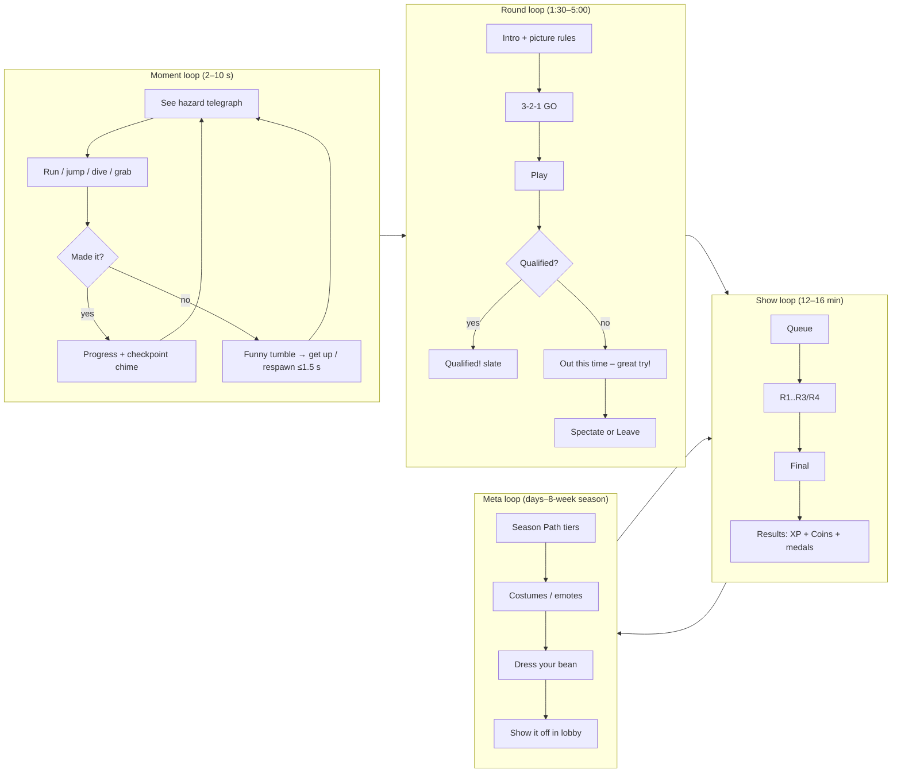
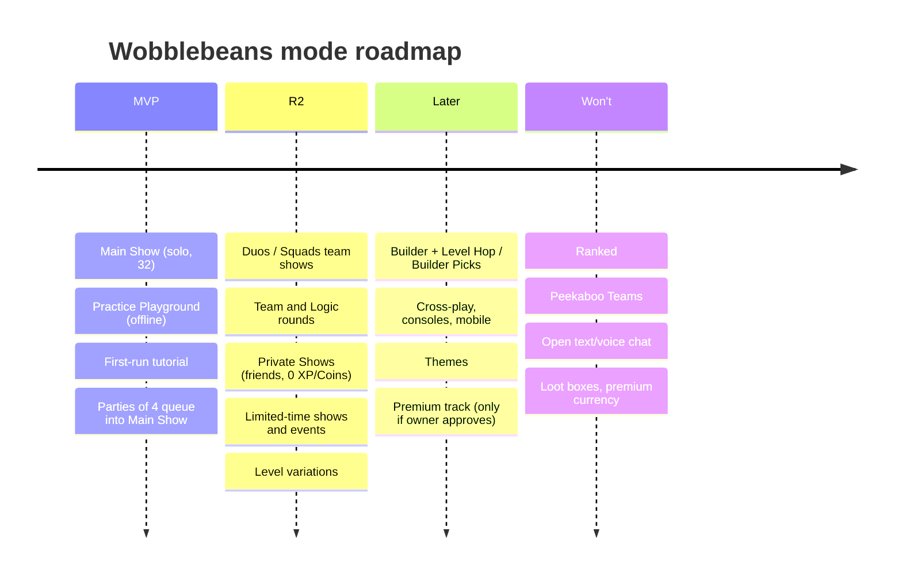
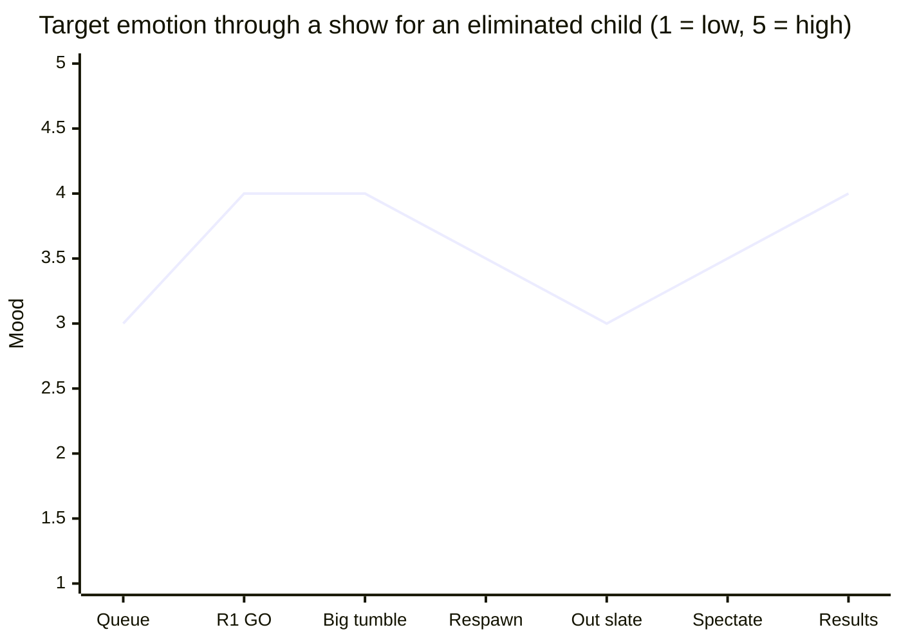

# Wobblebeans — Core Game Design Document (01)

| | |
|---|---|
| **Document** | 01-core-gdd.md — Core Game Design (pillars, fantasy, loop, show structure, modes, session flow, onboarding, fail-forward, difficulty & fairness) |
| **Version** | 1.0 — 23 Oct 2026 |
| **Owner** | Principal Game Designer |
| **Source of truth** | `Wobblebeans_Requirements_v3.docx` (v3.0, 174 active reqs), `Audit_Report_v3.md`, source chapters `01`–`12`, `gapfill-A`–`D` |
| **Scope defaults** | Engine-neutral (NFR-10-02, Q-A1) · PC (Windows) first (NFR-10-01, AD-51) · free, no real money in MVP (AD-12, Q-B1 default) · child-directed 6–12, PEGI 3 / ESRB E (UD-1, AD-01, AD-24) · no open chat (FR-11-03, AD-02) · placeholder art only (UD-3, FR-12-06, FR-12-10) |
| **Status** | Design-ready for MVP pre-production. All numbers are **design estimates** inherited from the requirements unless marked *new (GDD)*; every new value is a tunable default for playtest. |

> **How to read traceability.** Every design rule ends with a bracketed trace, e.g. `[FR-01-05 AC3; AD-10]`. Where this GDD resolves a conflict in the requirements, the rule is marked **⚑ Resolution** and listed in §13 *Issues found*. Reference-game (Fall Guys) facts are research only and never appear in product names, art or layouts (UD-2, AD-25, AD-38).

---

## Contents
1. Vision and design pillars
2. Player fantasy and audience
3. Core loop (moment, round, show, session, season)
4. Show structure (round sequencing, quotas, finals)
5. Modes — MVP vs R2 vs Later
6. MVP level set and round mix
7. Session flow (screens, timing, end-of-session)
8. Onboarding and tutorial for young kids
9. Fail-forward and "never feel like a loser" design
10. Difficulty and fairness
11. Social play inside the core loop (child-safe)
12. Tuning, telemetry and playtest gates
13. Issues found in the requirements (and how this GDD resolves them)
14. Traceability matrix
15. Open questions inherited from the owner list

---

## 1. Vision and design pillars

**Vision statement.** *Wobblebeans is a bright, giggly, 15-minute show where 32 wobbly beans tumble through obstacle rounds, and every child walks away with a laugh, a reward and a reason to try again — never a reason to feel bad.* [UD-1, UD-4, US-01-1]

### 1.1 Pillars

| # | Pillar | What it means | What it rules out | Trace |
|---|---|---|---|---|
| P1 | **Falling is funny** | Failure is slapstick, readable and fast to recover from. Beans always get up; there is no injury, damage state or scary content. | Long stun-locks, punishing respawns, violent framing. | FR-03-03 AC4, FR-04-05, AD-07, AD-24, FR-11-18 |
| P2 | **Everyone goes home with something** | Every round played pays XP and Coins; the Final always crowns at least one winner; copy is always kind. | Win-only rewards, zero-winner shows, "you lost" copy, quit punishments that feel like penalties. | FR-01-09 AC1, FR-01-05, AD-10, FR-08-03, AD-37, FR-06-13 AC2 |
| P3 | **Read it in one look** | Rules, hazards and rewards are understood from pictures, icons and motion, not reading. A 6-year-old can play without an adult. | Text-heavy rules, colour-only signals, hidden mechanics that punish first contact. | FR-08-19, FR-03-17, FR-08-11, FR-01-01 AC4, FR-02-05 AC2 |
| P4 | **Fair chaos** | Randomness and crowding create comedy, but outcomes are decided by the server, timers are visible and rules are deterministic. | Hidden rubber-banding, pay-to-win, off-by-one disputes, client-side authority. | FR-02-02 AC4, FR-01-04, AD-28, FR-05-01, FR-07-12, NFR-10-13 |
| P5 | **Safe by design, calm by design** | Play together without strangers talking; no pressure loops (no countdown offers, streaks, auto re-queue, loss framing). | Open chat, streak rewards, FOMO, "one more game" traps. | FR-11-03, FR-07-14, FR-08-18, AD-15, FR-11-15, FR-11-19 |

**Pillar priority when they collide:** P5 > P2 > P3 > P1 > P4. Example: if a fairer tie-break would yield a zero-winner Final, P2 wins (→ `final_draw_policy = all_win`, AD-10).

### 1.2 Design tests (apply to every feature)
1. *Would a 6-year-old understand it muted, without reading?* (P3)
2. *After the worst possible outcome, what does the child get?* — must be non-empty (P2)
3. *Does it create pressure to keep playing or to spend?* — must be "no" (P5, FR-08-18)
4. *Is the outcome decided by a rule a child could explain afterwards?* (P4)

---

## 2. Player fantasy and audience

### 2.1 Player fantasy
**"I'm a contestant on the silliest TV game show ever."** The player is a squishy, wobbly bean (silhouette and slot design only — final look comes from the owner's asset repository, FR-12-04, FR-12-10) who runs, jumps, dives and grabs through a giant colourful set. The show is the star: bright stages, big obstacles, a cheering crowd mood carried by music and visuals (no voiced presenter, AD-53).

| Fantasy beat | Delivered by | Trace |
|---|---|---|
| "I'm on stage" | Round intro fly-through + picture objective card | FR-08-04, gapfill-B §1.1, SC-04 |
| "I'm wobbly and it's hilarious" | Ragdoll stumbles, bumpers that bounce, auto get-up | FR-04-05, FR-03-03, AD-07 |
| "I made it!" | Big "Qualified!" slate, checkpoint chimes | SC-06, FR-03-12 AC2 |
| "I'm the champion" | Victory screen with equipped celebration, Trophy | FR-01-05 AC6, FR-06-07, AD-35 |
| "This is *my* bean" | Split upper/lower costumes, colours, patterns, faceplates (slots, not specific characters) | FR-05-02, FR-05-03, FR-05-17 |

### 2.2 Audience segments (all players get child protections — AD-01)

| Segment | Age | Needs | Key design responses |
|---|---|---|---|
| **Little Beans** | 6–8 | Pictures not words, short sessions, high success, adult nearby but not required | Picture-led tutorial ≥ 80% solo completion (FR-08-17 AC2), Year 2 reading level (FR-08-19), new-player lobbies (FR-01-02 AC5), R1 survive ≥ 55% for new cohort (gapfill-B §9 AT) |
| **Big Beans** | 9–12 | Mastery, showing off, playing with friends | Dive/grab skill ceiling (FR-04-03, FR-04-04), Trophy Rank (FR-06-07), parties of up to 4 approved friends (FR-07-03) |
| **Parents** | adult | Trust, control, no spending surprises | Parent Account, controls, playtime limits applied at show end (FR-11-02, FR-11-08, FR-11-15) |

---

## 3. Core loop

### 3.1 Loop layers



| Layer | Duration | Goal | Reward | Trace |
|---|---|---|---|---|
| Moment | 2–10 s | Pass one obstacle section | Progress, checkpoint cue; fall costs ≤ 12 s | FR-03-12, FR-03-13, gapfill-B §6.2 |
| Round | 1:30–5:00 + 22 s overhead | Qualify (finish quota / survive / score) | Qualified slate; +150 XP per qualified round | FR-01-04, FR-02-02..04, gapfill-B §1, gapfill-C §1 |
| Show | 12–16 min median | Reach the Final, win a Trophy | Participation XP, Final bonus, win bonus, Coins, medals | FR-01-03, FR-01-05, FR-01-09, gapfill-B §9 |
| Session | ~1–4 shows | Have fun, progress a bit | Season Path tier progress, challenges | FR-06-01, FR-06-13, FR-11-15 |
| Season | 8 weeks | Unlock free-track cosmetics | 70-tier free Season Path | FR-06-02, AD-11, AD-14 |

### 3.2 Moment-to-moment verbs (MVP)
Move, Jump, Dive, Grab, Emote — and nothing else. Every MVP level must be completable with Move + Jump; Dive and Grab are *advantage* verbs, never *gate* verbs (*new (GDD)*, supports P3; physics per FR-04-01..04, AD-31). Grab can be toggle or hold (FR-08-12). Emotes cancel on any input and are not usable airborne/grabbing/ragdolled (AD-34).

---

## 4. Show structure

### 4.1 Main Show (MVP) at a glance
- Lobby: 32 target (config 8–40) [AD-05, FR-01-02, NFR-10-03]
- Rounds: up to `MAX_ROUNDS = 5`; typical 3 qualifiers + Final [gapfill-B §3.4, US-01-1]
- Final when `N ≤ FINAL_MAX (10)` or `round_idx = MAX_ROUNDS` [AD-29]
- No repeated level in a show; no same round type twice in a row unless forced [FR-01-03 AC2–AC3]
- Show length median 12–16 min; Final 2–4 min [gapfill-B §9]

### 4.2 Show state machine

```mermaid
stateDiagram-v2
  [*] --> Queue: Press Play (leader only in party)
  Queue --> Menu: Cancel (no penalty)
  Queue --> LowPop: 120 s, no start
  LowPop --> Practice: Practice Playground
  LowPop --> Queue: Try again
  Queue --> RoundIntro: Lobby filled (D-12 steps)
  RoundIntro --> Countdown: 6 s intro + 2 s spawn hold
  Countdown --> Play: 3-2-1-GO
  Play --> Outcome: quota met / time limit / quota impossible
  Outcome --> Interstitial: Qualified (3 s slate)
  Outcome --> Spectate: Out (3 s slate)
  Spectate --> Results: show ends
  Spectate --> Menu: Leave (keeps earned rewards)
  Interstitial --> RoundIntro: N > 10 and round_idx < MAX_ROUNDS
  Interstitial --> FinalIntro: N ≤ 10 or round_idx = MAX_ROUNDS
  Interstitial --> Results: N = 1 (instant win)
  FinalIntro --> Final
  Final --> Results: ≥1 winner always (all_win on tie/time-out)
  Results --> Menu: always; Play again is a manual press
  Menu --> [*]
```


Trace: FR-01-02 AC1/AC8, FR-01-03, FR-01-04 AC1, FR-01-05 AC2–AC5, FR-07-11, FR-08-04, FR-08-18 (no auto re-queue), FR-07-03 (leader queues), AD-29.

### 4.3 Round phase timeline (every round)

| Phase | Default | Purpose | Trace |
|---|---|---|---|
| Intro fly-through + picture "How to play" card | 6.0 s | Readability, loading cover | gapfill-B §1.1, SC-04 |
| Spawn hold (input locked) | 2.0 s | Net settle | gapfill-B §1.1 |
| 3-2-1-GO | 3.0 s | Fair start, 0 early-movement events | gapfill-B §1.1 AT |
| Play | per type (§4.5) | — | gapfill-B §1.2 |
| Final-seconds banner | last 15 s (solo) | Visible, not flashing > 3 Hz | gapfill-B §1.1, FR-08-02, NFR-10-19 |
| Qualified / Out slate | 3.0 s | Emotion beat | SC-06 |
| Between-round results | 8.0 s | Read next quota; loading | gapfill-B §1.1 |

Fixed overhead ≈ 22 s per round (target median ≤ 25 s).

### 4.4 Slot planning and round selection

| Slot | When | MVP type weights (renormalised, ⚑ ISS-05) | R2+ type weights (requirement) |
|---|---|---|---|
| R1 | round 1, N > 10 | Course 80 · Survival 10 · Points 10 | same |
| R2 | round 2, N > 10 | Course 39 · Survival 33 · Points 28 | Course 35 · Survival 30 · Points 25 · Logic 10 |
| R3/R4 | round 3–4, N > 10 | Survival 44 · Points 34 · Course 22 | Survival 40 · Points 30 · Course 20 · Logic 10 |
| F | N ≤ 10 or round 5 | Final pool, filtered by maxP | same |
| — | N = 1 | instant win | same |

Selection: valid candidates by slot, min/max players and team divisor, minus already-played levels, minus last round's type unless that empties the set; weighted by `type_weight × level.weight × freshness` (× 0.5 if > 50% of the lobby played it in their last 3 shows); look-ahead guarantees a valid Final; fallback level if empty. [FR-01-03 AC1–AC7, FR-02-01, gapfill-B §3.3, AD-29]

**Worked example (32 players, MVP defaults):** R1 Course 70% → 22 · R2 Survival 60% → 13 · R3 Points 60% → 8 (≤ 10) → **R4 = Final**. Four rounds, ~14 min. [gapfill-B §2.1, §2.2; AD-28 round-half-down applies only to exact .5 ties]

### 4.5 Round types and how qualification works

| Type | Release | Qualify rule | Default limit | Fall rule | Trace |
|---|---|---|---|---|---|
| Course (race) | MVP | First `quota` finishers | 3:00 (2-lap 3:30, rising slime 2:20) | Respawn at checkpoint (slime variants eliminate) | FR-02-02, FR-03-13, FR-03-14 |
| Survival | MVP | Survive timer, or round ends when alive ≤ quota | 1:45–2:00 | Eliminate | FR-02-03 |
| Points (hunt) | MVP | Top `quota` by score at time | 2:00 | Respawn | FR-02-04 |
| Final — survival / trophy-grab | MVP | Last standing / first grab; ties & time-out → all remaining win | 5:00 (tunable 3–6) | Eliminate | FR-01-05, AD-10 |
| Team | R2 | Bottom `max(1, floor(teams/3))` teams out | 2:00 | per level | FR-02-06, FR-01-06, AD-28 |
| Logic | R2 (Could) | Survive picture prompts; answers ≤ 20 | 1:50 | Eliminate | FR-02-05 |
| Peekaboo Teams | Won't | — | — | — | FR-02-08, AD-48 |

Quota: `quota = clamp(round_half_down(N × pct), 1, N − 1)`; disconnects count as eliminated and do not shrink the quota; if remaining-able ≤ remaining spots, all qualify immediately. [FR-01-04, gapfill-B §2.1, AD-28]

### 4.6 Finals — "there is always a champion"
- Trophy-grab: first server-timestamped grab wins (FR-01-05 AC1).
- Survival: last standing wins; exact sub-tick tie → all tied win (AC2, AD-10).
- Time-out: every player still in wins (AC3, AD-10).
- Bots never enter a Final; bots rank below humans before the Final (FR-01-02 AC7, AD-17). If only bots remain, the show closes with no winner recorded (FR-01 edge case 9) — players who left already have their rewards, so no child sees a zero-winner screen.
- Winners see SC-08 victory with equipped celebration for 8 s (FR-01-05 AC6, AD-35).

---

## 5. Modes — MVP vs R2 vs Later



| Mode | Release | Players | Rewards | Design purpose | Trace |
|---|---|---|---|---|---|
| **Main Show** (solo) | MVP · Must | 8–32 (target 32) | Full XP/Coins/Trophy | The game | FR-01-01, FR-01-02..05, FR-01-09, AD-05 |
| **Practice Playground** | MVP · Should | 1 + 0–7 practice bots, offline | None (anti-farm) | Learn safely, low-pop fallback, accessibility | FR-01-12, FR-08-12, AD-18 |
| **First-run tutorial** | MVP · Must | 1, offline | Small cosmetic on first completion *new (GDD), tunable; never XP* | Teach verbs | FR-08-17, AD-44 |
| **Party queue into Main Show** | MVP · Should | up to 4 approved friends | Normal | Play with friends | FR-07-03, AD-52 |
| **Duos / Squads** | R2 · Should | 32 in teams of 2/4 | Team win counts for all; best team medal | Cooperative belonging | FR-01-06, FR-02-06, US-01-2 |
| **Private Shows** | R2 · Should | 2–32 approved friends | 0 XP / 0 Coins | Birthday-party play | FR-07-08, AD-19 |
| **Limited-time shows** | R2 · Should | per playlist | Event rewards earnable in ≤ 4 h; no countdown UI | Freshness without FOMO | FR-09-23, FR-01-01 AC3, AD-15 |
| **Level Hop / Builder Picks** | Later · Could | ≥ 20 | Capped XP | UGC | FR-01-08, FR-09-01..18 |
| Ranked | Won't | — | — | Competitive pressure unsuitable | FR-01-07, AD-16 |

**MVP design rule:** the Show Picker exists but shows one card (Main Show) — the hub's big Play button goes straight to it (FR-01-01, SC-01/SC-02). Grouping appears only when > 4 shows exist.

---

## 6. MVP level set and round mix

8 original levels from the 11 MVP obstacles (Swing Ball, Spin Bar, Spin Mallet, Tilt Plank, Conveyor, Bumper, Pusher Block, Launch Arm, Trick Door, Drop Tile, Slime). Names are placeholders; layouts are original and pass legal review. [FR-02-11, FR-03-01, AD-38, AD-40, AD-25]

| # | Placeholder | Type | Slots | Players | Core obstacles | Fall rule |
|---|---|---|---|---|---|---|
| L1 | Wobble Dash | Course | R1, R2, R3 | 8–40 | Spin Bar, Bumper, Tilt Plank, Trick Door | Respawn |
| L2 | Conveyor Canyon | Course | R1, R2 | 12–40 | Conveyor, Pusher Block, Launch Arm, Swing Ball | Respawn |
| L3 | Slime Climb (rising) | Course (rising slime) | R2, R3 | 8–32 | Slime, Spin Mallet, Tilt Plank | Eliminate on slime |
| L4 | Bumper Bowl | Survival | R1, R2, R3 | 8–40 | Spin Bar (escalating), Bumper | Eliminate |
| L5 | Plank Party | Survival | R2, R3 | 8–32 | Tilt Plank, Swing Ball, Slime floor | Eliminate |
| L6 | Bean Bell Hunt | Points (zone/button) | R1, R2, R3 | 8–40 | Pusher Block, Conveyor, Bumper | Respawn |
| L7 | Tile Drop (fallback) | Final — survival | F | 2–40 | Drop Tile layers, Slime | Eliminate |
| L8 | Summit Scramble | Final — trophy grab | F | 2–10 | Launch Arm, Spin Mallet, Swing Ball, Slime | Respawn until summit plateau *(GDD: respawn keeps the Final from ending at a 10-s fall)* |

**Coverage check (FR-02-11 AC3: ≥ 2 candidates per non-final slot, 2 finals, N = 8–32):** R1 → L1, L2, L4, L6; R2 → L1–L6; R3/R4 → L1, L3, L4, L5, L6; F → L7, L8. ✔ Note L2 requires N ≥ 12 so at N = 8–11 R1 still has L1, L4, L6.

---

## 7. Session flow

### 7.1 Screen flow

```mermaid
flowchart TD
  Boot[Launch] --> First{First run?}
  First -- yes --> OB[SC-12 Onboarding: language → controller check → tutorial]
  First -- no --> Hub
  OB -- completed or "Play now" --> Hub[SC-01 Hub: bean preview + big PLAY]
  Hub --> Picker[SC-02 Show Picker]
  Hub --> Dress[SC-09 Dressing Room / Coin Shop]
  Hub --> Path[Season Path]
  Hub --> Practice[SC-15 Practice Playground]
  Hub --> Settings[SC-10 Settings]
  Hub --> Parent[SC-11 Parent gate]
  Picker --> Queue[SC-03 Lobby: counter, 'Some players may be computer players', quick-chat]
  Queue --> Intro[SC-04 Round intro] --> HUD[SC-05 In-round] --> Slate[SC-06 Qualified / Out]
  Slate -->|qualified| Intro
  Slate -->|out| Spec[SC-07 Spectate] --> Results
  Slate -->|show over| Results[SC-08 Results: itemised XP + Coins + medals]
  Results --> Break{Break reminder / parent limit reached?}
  Break -- yes --> Rest[Friendly 'Time for a stretch!' screen]
  Break -- no --> Hub
  Rest --> Hub
```
Trace: FR-08-04, FR-08-17, FR-01-12, FR-07-11, FR-01-09, FR-11-15 AC1–AC2, FR-08-16 (offline states, SC-14).

### 7.2 Session pacing targets

| Moment | Target | Trace |
|---|---|---|
| Launch → first input in tutorial | ≤ 60 s *(new GDD target)* | NFR-10-18 |
| Press Play → round start (P50 / P95) | ≤ 20 s / ≤ 60 s queue + ~11 s intro | D-12 AT |
| Show length | 12–16 min median | gapfill-B §9 |
| Typical session | 2–4 shows (~30–60 min); break reminder at 60 min | FR-11-15, AD-23 |
| Limits never interrupt a round | 100% | FR-11-15 AC2 |

### 7.3 Ending a session well
- After SC-08 the child returns to the hub; **no auto re-queue**, no "one more" prompt, no purchase prompt (FR-08-04 AC2, FR-08-18, FR-01-09 AC3).
- Leaving mid-show is always allowed and never punished; earned per-round rewards are kept (AD-37, FR-01-04 AC2; ⚑ ISS-01).
- Unfinished daily challenges bank for up to 7 days; rested XP welcomes the child back — absence never costs anything (FR-06-13, gapfill-C §1, AD-15).

---

## 8. Onboarding and tutorial for young kids

### 8.1 Principles
1. **Show, don't tell** — no voice-over, single words only; every instruction is an animated pictogram of the input + the bean doing it (FR-08-17, FR-08-19, AD-53).
2. **Do it, then name it** — the child performs the verb before any icon label appears.
3. **Can't fail the tutorial** — no timers, no elimination; falling respawns in place within 1 s.
4. **≤ 5 minutes median, offline** (FR-08-17 AC1, AC3; AD-44).
5. **Skippable without shame** — "Play now" is always available on first run; the tutorial is offered again next launch (FR-08-17). ⚑ ISS-07.

### 8.2 Tutorial path (runs inside the Practice Playground space — ⚑ ISS-02)


| Station | Teaches | Success condition | Assist after 3 tries / 20 s | Trace |
|---|---|---|---|---|
| Move | stick/WASD | reach marker | glowing footprints path | FR-04-01 |
| Jump | jump | 3 hops | hops get lower | FR-04-02, AD-31 |
| Dive | jump + dive | clear 4 m gap | gap shrinks to 3 m | FR-04-03 |
| Grab | hold/toggle grab | pull lever 1 s | grab auto-toggles on; hint to Settings | FR-04-04, FR-08-12 |
| Bump & tumble | ragdoll is OK | get bounced once | — (automatic) | FR-03-03 AC2, FR-04-05, P1 |
| Say hi | emote, quick-chat | send one | — | FR-05-06, FR-07-14 |
| Mini-race | full loop | cross finish | bots slow down (practice only) | FR-01-12 AC3 |

### 8.3 First five shows (new-player protection)
- Matched with other new players + disclosed bots (FR-01-02 AC5, AD-17); 20 s fallback to normal queue.
- R1 for this cohort targets ≥ 55% survival (gapfill-B §9 AT). R1 type weight Course 80 favours the most-learnable type.
- Round intro card always shows the type icon + quota pictogram ("first 22 beans through!").
- After show 1 the hub highlights the Dressing Room once (non-blocking, not a pop-up during play) so the child learns rewards are cosmetic (FR-05-01, FR-08-18).

---

## 9. Fail-forward and "never feel like a loser" design

### 9.1 The emotional curve we design for


Rule: no step in a show may drop below "3 — okay". Elimination is a pause, not a punishment.

### 9.2 Fail-forward toolkit

| Lever | Rule | Trace |
|---|---|---|
| Fast recovery | Knockdown 1.2–3.0 s, 0.5 s re-knockdown immunity; ≤ 2 knockdowns in 4 s | FR-04-05, gapfill-A §5.3 |
| Cheap falls | Respawn 1.5 s + 1 s protection; ≤ 12 s progress lost; checkpoints never move you back | FR-03-12, FR-03-13 |
| Gentle bumps | Bean-to-bean bumps never knock down (Δv ≤ 5); bumpers never knock down | FR-04-05 AC1, AD-07 |
| Rewards for trying | +100 XP participation, +150 per qualified round, Coins per round; itemised ("Qualified round 2: +10") | FR-01-09 AC1, FR-06-06, gapfill-C §1 |
| Medals for progress | Results show a medal per round reached, not a rank number out of 32 *(GDD: placement number hidden for eliminated players; shown for finalists only)* | FR-01-09, FR-08-03 |
| Kind copy | No "lose/lost/loser/fail/dead/die/kill"; "Out this time – great try!" | FR-08-03 |
| Something to do | Spectate with party members first, quick-chat cheers ("Nice!", "Wow!") | FR-07-11, FR-07-14 |
| Champions always exist | all_win ties and time-outs | FR-01-05, AD-10 |
| Non-win goals | 0 challenges require a win; 0 reward grabbing/knocking others | FR-06-13 AC2 |
| No leaver penalty | Leave any time, keep what you earned, return to party after the show | AD-37, FR-07-11 AC3 |
| Personal bests *(new GDD, R2 Should)* | "Furthest round" sticker on SC-08 when beaten — local only, no streaks | FR-08-18 compliant |

### 9.3 Anti-patterns banned in core design
Leaderboards of strangers · placement shaming ("32nd") · streaks · "you missed out" · countdown offers · pop-ups during play · win-gated cosmetics on the free path · elimination by another player's grab in R1 (*GDD content rule: R1 levels must not have grab-to-eliminate mechanics*). [FR-08-18, FR-06-02 AC2, AD-15]

---

## 10. Difficulty and fairness

### 10.1 Difficulty curve across a show

| Slot | Target eliminated | Hazard density | speed_mult | Fail risk / obstacle | Variants |
|---|---|---|---|---|---|
| R1 | ~30% | low–medium, wide lanes | 1.0 | 5–10% | none |
| R2 | ~40% | medium, mixed | 1.0–1.15 | 10–15% | "Faster" 20% (R2 release) |
| R3/R4 | ~40% | medium–high | 1.1–1.25 | 15–20% | "Faster" 20% (R2 release) |
| Final | → winner(s) | high, escalates in-round (smoothstep) | escalating | — | — |
Trace: gapfill-B §9, §5; FR-02-03 AC2; FR-03-04; FR-03-15 (variants R2).

### 10.2 In-level difficulty rules (level design contract)
1. **Telegraph everything:** motion visible before contact, ≥ 3:1 outline contrast, ≥ 80% of 6–10s can explain a hazard after one encounter (FR-03-17).
2. **Never by colour alone:** tiles, teams, hazards use pattern/icon too (FR-08-11).
3. **Multiple routes per section:** an easy-but-slow lane and a fast-but-risky lane in every Course section *(GDD rule, supports P3/P4)*.
4. **Reach limits:** gaps ≤ 3 m (jump) / ≤ 5 m (jump+dive) (AD-31).
5. **Hidden-info is fair-on-contact:** trick doors/fake tiles revealed only on server contact, randomised per match (FR-02-02 AC4).
6. **No checkpoint loops:** never place a checkpoint where a launcher failure returns you > 3 times in a row (gapfill-B §6.2).
7. **Escalation, not ambush:** survival hazards ramp so < 25% of eliminations occur in the first third (gapfill-B §5 AT).

### 10.3 Fairness model

| Fairness promise | Mechanism | Trace |
|---|---|---|
| Same rules for everyone | Cosmetics have no gameplay effect | FR-05-01 |
| Server decides | Authoritative 50 Hz sim, sub-tick tie-breaks, anti-cheat speed check | FR-07-12, AD-06, AD-09, gapfill-B §2.3 |
| Deterministic counts | Round-half-down quota, visible quota on intro card and HUD | AD-28, FR-08-01 |
| Fair start | Input locked until GO | gapfill-B §1.1 |
| Leavers don't distort | Quota not recomputed on disconnects; 60 s reconnect, 2 per show | FR-01-04 AC3, FR-07-16 |
| Honest bots | Disclosed, ≤ 40%, never in Final, rank below humans | FR-01-02 AC7, AD-17 |
| Matching without stress | Loose 3-band hidden MMR only with big pools; no Ranked | D-13, AD-16 |
| Variety is fair | No repeats, freshness weighting | FR-01-03 |
| Assist without secret rubber-banding | Assists are *visible and opt-in* (Practice, grab toggle, hold-to-mash) — no hidden catch-up in competitive rounds | FR-08-12, P4 |

### 10.4 Accessibility as difficulty control
Grab toggle, hold-to-mash, text 100/125/150%, visual audio cues, motion comfort (blur off, shake toggle, FOV 60–85°), photosensitivity limit, full rebinding. [FR-08-12, FR-08-13, FR-08-20, NFR-10-19, FR-04-12]

---

## 11. Social play inside the core loop (child-safe)
- Parties of up to 4 **parent-approved** friends; leader-only queue; never split (FR-07-03, FR-07-07, AD-04, AD-52).
- Communication = preset positive phrases + emotes only; ≤ 2 inputs to send; mute in ≤ 2 interactions; parent can disable (FR-07-14, FR-11-03).
- Generated display names (Adjective+Noun+2 digits) (FR-11-04, AD-03).
- Report and block in ≤ 2 interactions, picture-led (FR-11-06, FR-07-15, AD-43).
- Team shows (R2): one team win counts for all; non-qualifying member gets the team's best medal — the purest expression of P2 (FR-01-06 AC3).

---

## 12. Tuning, telemetry and playtest gates

| Gate | Metric | Pass | Trace |
|---|---|---|---|
| G1 Tutorial | 6–8s complete unaided; median time | ≥ 80%; ≤ 5 min | FR-08-17 |
| G2 Readability | hazard explained after 1 encounter | ≥ 80% | FR-03-17 AC2 |
| G3 Falls feel funny | survey "funny" / "unfair" | ≥ 70% / ≤ 20% | gapfill-A §5.2 AT |
| G4 Fall cost | median progress lost per fall | ≤ 12 s | FR-03-12 AC3 |
| G5 Show length | median show | 12–16 min | gapfill-B §9 |
| G6 New-player R1 | survival of < 5 h cohort | ≥ 55% | gapfill-B §9 |
| G7 Downtime | median non-play overhead/round | ≤ 25 s | gapfill-B §1 AT |
| G8 Sequencing | Monte-Carlo 10k shows | no repeats; fallback < 2% | FR-01-03 AC7 |
| G9 Kind copy | banned-word & urgency lint | 0 hits | FR-08-03, FR-08-18 |
| G10 Emotion | eliminated children rating "I want to play again" (no prompt shown) *new GDD* | ≥ 75% | P2 |

All values live in data config (NFR-10-20). Telemetry is pseudonymous and minimal (NFR-10-12, AD-21).

---

## 13. Issues found in the requirements (and how this GDD resolves them)

| ID | Type | Requirements involved | Problem | Resolution adopted in this GDD |
|---|---|---|---|---|
| **ISS-01** | Contradiction | FR-01-09 AC4 vs FR-06-01 (body + AC3), gapfill-C §1 | FR-01-09 says quitting mid-show "forfeits only the participation bonus" (per-round XP kept); FR-06-01 says "Quitting a show grants 0 XP". Also tension with AD-37 (no leaver penalty) and FR-01-04 AC2 (eliminated keep earnings). | **Quit = keep all per-round XP/Coins already earned; forfeit only the +100 participation XP** (and Final/win bonuses not reached). Read FR-06-01 "0 XP for a quit" as "0 *participation* XP". Proposed edit: FR-06-01 AC3 → "0 participation XP is granted for a quit". Leaving *after* elimination is not a quit (participation kept). |
| **ISS-02** | Duplicate / overlap | FR-08-17 (tutorial "in an offline space") vs FR-01-12 (Practice Playground "contains … tutorial stations") | Two features describe the same offline tutorial space without saying they are one. | One offline space: the **tutorial is a guided path through the Practice Playground** (§8.2). FR-08-17 owns tutorial flow/ACs; FR-01-12 owns the free-play space. |
| **ISS-03** | Wrong cross-reference | FR-01-12 body, US-01-7 | Cite "tutorial stations of **FR-08-16**" — FR-08-16 is *Error, offline and empty states*; the tutorial is **FR-08-17**. | Treated as FR-08-17. Fix the reference. |
| **ISS-04** | Contradiction / ambiguity | FR-01-05 AC5 vs AD-29, gapfill-B §3.2–3.4, FR-02-01, FR-01-03 | FR-01-05 AC5: "If 2–10 players are left **before round 4**, the next round is a Final" — implies Final only from round 4. AD-29: Final whenever N ≤ 10 *or* round_idx = MAX_ROUNDS (5). Also FR-02-01/FR-01-03 list slots R1, R2, R3, F only, while gapfill-B §3 has R4 and MAX_ROUNDS = 5. | **AD-29 governs**: Final at any round when 2 ≤ N ≤ 10, or at round 5. Slot set is {R1, R2, R3, R4, F}, with R4 sharing R3's weights. Proposed edit: FR-01-05 AC5 → "If 2–10 players remain after any round, the next round is a Final"; add R4 to FR-02-01. |
| **ISS-05** | Scope conflict | gapfill-B §3.2 slot weights vs FR-02-05 (Logic = Could, R2) | R2 and R3/R4 slot weights include Logic 10, but no Logic level exists in MVP — the weights can't be met and the §3.4 AT ("type mix within ±5% of weights") would fail. | MVP uses **renormalised weights without Logic** (§4.4). Original weights apply once Logic ships (R2). |
| **ISS-06** | Contradiction (numbers) | FR-01-02 AC7 / D-11 default vs D-11 AT, D-12 | D-11: fill "to 32" with bots if < 20 humans at 60 s, but cap is 12 bots (≤ 40%) — with < 20 humans, 32 is unreachable. D-11 AT expects a show to start with **10** humans (10 + 12 = 22). D-12: "T = 60 s ≥ 20 + bots" is ambiguous (20 humans, or 20 total?). | At 60 s: **start if humans ≥ 8 (Main Show min) and humans + bots ≥ 20, with bots = min(12, 32 − humans)**. A lobby of 10 humans starts with 22 beans. Slot/final selection uses the real N (FR-01-03 handles any 8–40). |
| **ISS-07** | Ambiguity | FR-08-17 | "Skipped after the first completion" vs "Pressing Play straight away is allowed" on first run. | Before first completion: a **"Play now"** button bypasses it (offered again next launch). After completion: tutorial no longer auto-runs, replayable from Settings. No "Skip" during a station is needed. |
| **ISS-08** | Terminology / consistency | Ch.1 "Area" and core-loop text ("Crown wins", "Game Selector") vs glossary (Trophy, Show Picker); SC-03 inventory string "AI players may join" vs FR-01-02 AC7 "Some players may be computer players" | Reference terms leak into normative chapter text; two different disclosure strings. | Use **Trophy** and **Show Picker** throughout; single disclosure string from FR-01-02 AC7 ("Some players may be computer players") — simpler for 6–8 (FR-08-19). |
| **ISS-09** | Wrong cross-reference | FR-01-08 AC2 | "passed moderation (FR-09-18, **FR-11-12**)" — FR-11-12 is *Data access, export and deletion*; moderation ops is **FR-11-17**. | Treated as FR-09-18 + FR-11-17 (Later scope). |
| **ISS-10** | Missing rule | FR-01-03 AC4 / gapfill-B §3.3 fallback | Fallback for any empty slot is "Tile Drop", a 5:00 Final-type level; using it mid-show (non-final slot) would end in one winner or blow the show length. | Fallback in a non-final slot = **Tile Drop with a qualifier quota (60%, 1:45 limit)**; in the F slot = normal Tile Drop Final. Requires FR-02-01 per-slot overrides (FR-01-04 AC4 allows per-show limits). |
| **ISS-11** | Missing rule (fairness/child-safety) | FR-02-04 (tail grabs) in MVP Points pool vs FR-06-13 AC2 spirit, FR-08-03 | Points rounds include grab-to-steal tails; for R1 new players this makes another child the direct cause of elimination. | GDD content rule: **grab-steal Points levels are not allowed in R1**; MVP Points level (L6) uses zones/buttons. |
| **ISS-12** | Ambiguity | FR-01-05 AC3 (trophy-grab time-out all win) + respawn finals | A trophy-grab final with respawns could time out with many "winners", diluting the Trophy. | Accepted (AD-10, P2), but L8 tuned so time-out occurs in ≤ 5% of runs (gapfill-B §1.2 AT); telemetry gate. |

No other duplicates/conflicts were found within this GDD's scope; the 34 duplicates already merged in v3 (e.g. DUP-02 FR-02-09→FR-01-03, DUP-04 FR-02-07→FR-01-05, DUP-08 FR-01-11→FR-07-08, DUP-09 FR-02-10→FR-03-15) are honoured and retired IDs are not used as design anchors.

---

## 14. Traceability matrix

| GDD section / decision | Requirement IDs |
|---|---|
| §1 Pillars P1–P5 | FR-03-03, FR-04-05, FR-01-05, FR-01-09, FR-08-03, FR-08-19, FR-03-17, FR-08-11, FR-05-01, FR-07-12, FR-11-03, FR-07-14, FR-08-18, FR-11-15, FR-11-19; UD-1, UD-4; AD-07, AD-10, AD-15, AD-24, AD-37 |
| §2 Fantasy & audience | FR-12-04, FR-12-10, FR-05-02, FR-05-03, FR-05-17, FR-06-07, AD-01, AD-35, AD-53 |
| §3 Core loop | FR-01-01..05, FR-01-09, FR-03-12, FR-03-13, FR-06-01, FR-06-02, FR-06-13, FR-04-01..04, AD-11, AD-14, AD-31, AD-34 |
| §4 Show structure | FR-01-02..05, FR-02-01..06, FR-03-14, FR-07-03, FR-07-11, FR-08-04, AD-05, AD-17, AD-28, AD-29, gapfill-B §1–3, D-12 |
| §5 Modes | FR-01-01, FR-01-06, FR-01-07, FR-01-08, FR-01-12, FR-02-08, FR-07-03, FR-07-08, FR-09-23, AD-16, AD-18, AD-19, AD-48, AD-51 |
| §6 MVP levels | FR-02-11, FR-03-01, FR-02-01, AD-25, AD-38, AD-40 |
| §7 Session flow | FR-08-04, FR-08-16, FR-08-17, FR-08-18, FR-11-15, FR-06-13, NFR-10-18, AD-23 |
| §8 Onboarding | FR-08-17, FR-08-19, FR-01-12, FR-01-02 AC5, FR-04-01..04, FR-05-06, FR-07-14, AD-44 |
| §9 Fail-forward | FR-04-05, FR-03-12, FR-03-13, FR-01-09, FR-06-06, FR-08-03, FR-07-11, FR-01-05, FR-06-13, AD-10, AD-37 |
| §10 Difficulty & fairness | FR-03-17, FR-08-11, FR-02-02, FR-02-03, FR-03-04, FR-03-15, FR-05-01, FR-07-12, FR-07-16, NFR-10-13, FR-08-12, FR-08-13, FR-08-20, NFR-10-19, AD-06, AD-09, AD-16, AD-28, AD-31 |
| §11 Social | FR-07-03, FR-07-07, FR-07-14, FR-07-15, FR-11-03, FR-11-04, FR-11-06, FR-01-06, AD-03, AD-04, AD-43, AD-52 |
| §12 Gates | NFR-10-12, NFR-10-20, plus ACs cited inline |

## 15. Open questions inherited (defaults used)
Q-A1 "MiniMax" → engine-neutral · Q-A2 age 6–12 · Q-B1 stay fully free · Q-C1 no store-specific features · Q-C2 UK/EEA/US · Q-D2 placeholder art. None block this GDD.
