# 03 — Character Movement, Physics Feel & Controls (Wobblebeans)

Owner: Gameplay/Feel Design · Status: Draft v1 (2026-10-23) · Audience: kids 6–12, PC (Windows) MVP (AD-51)
Sources of truth: `Wobblebeans_Requirements_v3.docx` (Ch. 4, 5, 8, 10, 12, 13), `gapfill-A-physics-controls.md` (§1–§8), `04-controls-physics.md`.
All numbers are **design estimates (not confirmed from Fall Guys)** from gapfill-A §8, locked only after movement-lock gate M0 (Ch. 17, DEP-02). No Fall Guys names, art or audio are used (UD-2, AD-25).

**Feel pillars:** (1) *Floppy but controllable* — wobble is visual, control is crisp (≤0.25 s to full speed). (2) *Falls are funny, never unfair* — slapstick tumbles, short and capped. (3) *Forgiving for small hands* — buffers, coyote time, fixed jump, assist options. (4) *Readable in a crowd of 32* — clear silhouettes, cues and camera.

---

## 1. Character state machine

Simulation runs on one 50 Hz fixed step on client and server (AD-06, FR-07-12). The local client predicts; the server validates and owns grabs, knockdowns and respawn.

```mermaid
stateDiagram-v2
    [*] --> Idle
    Idle --> Run: move input > deadzone (0.15)
    Run --> Idle: no input, decel 60 m/s²
    Idle --> Jump: jump (grounded or coyote ≤0.10 s or buffered ≤0.12 s)
    Run --> Jump: jump
    Run --> Fall: leave ledge (coyote 0.10 s still allows jump)
    Idle --> Fall: floor removed (tile decay, trick door)
    Jump --> Fall: apex reached (gravity ×1.5)
    Fall --> Idle: land, vy > -18 m/s
    Fall --> Run: land with move input
    Fall --> Stumble: land -20 < vy ≤ -18 m/s (not bounce pad)
    Fall --> Ragdoll: land vy ≤ -20 m/s
    Idle --> Dive: dive (ground)
    Run --> Dive: dive (ground)
    Jump --> Dive: dive (air; once per airborne period)
    Fall --> Dive: dive (if air dive unused)
    Dive --> DiveSlide: touchdown, slide decel 14 m/s²
    DiveSlide --> Recover: slide ends / 0.55 s recovery window
    Recover --> Jump: jump after 0.40 s (cancel)
    Recover --> Idle: 0.55 s elapsed
    Idle --> Grab: hold grab
    Run --> Grab: hold grab
    Grab --> Idle: release / target lost / 3.0 s cap on player
    Grab --> Climb: grabbing ledge + forward input
    Climb --> Idle: mantle done
    Idle --> Grabbed: server-confirmed grab on me
    Run --> Grabbed: server-confirmed grab on me
    Grabbed --> Run: break-free / 3.0 s cap / grabber stunned
    Idle --> Stumble: impact Δv ≥ 4 m/s (or player bump, capped 5)
    Run --> Stumble: impact Δv ≥ 4 m/s
    Jump --> Stumble: impact Δv 4–8 m/s
    Stumble --> Run: 0.30 s (impact) / 0.35 s (hard land)
    Idle --> Ragdoll: Δv ≥ 8 m/s or knockdown-tagged hazard
    Run --> Ragdoll: Δv ≥ 8 m/s or knockdown tag
    Jump --> Ragdoll: Δv ≥ 8 m/s or knockdown tag
    Dive --> Ragdoll: Δv ≥ 8 m/s or knockdown tag
    Grab --> Ragdoll: Δv ≥ 8 m/s (releases grip)
    Grabbed --> Ragdoll: Δv ≥ 8 m/s (releases)
    Ragdoll --> GetUp: speed < 1.5 m/s for 0.2 s, or 3.0 s cap
    GetUp --> Idle: 0.9 s (then 0.5 s knockdown immunity)
    Idle --> Emote: emote key (grounded only)
    Emote --> Idle: any move/jump/dive/grab cancels (AD-34)
    Fall --> Eliminated_or_Respawn: enters slime / kill volume
    Eliminated_or_Respawn --> Idle: race respawn 1.5 s, 1 s spawn i-frames (FR-03-13)
```

`Fall` and `Jump` share the *Airborne* super-state (air accel 18 m/s², one air dive). `Climb`, `DiveSlide`, `GetUp`, `Grabbed` and `Emote` are sub-states needed for animation and gating, not new requirements.

### 1.1 State rules and gating

| State | Player control | Can enter Jump / Dive / Grab | Exit | Trace |
|---|---|---|---|---|
| Idle | full | Y / Y / Y | input | FR-04-01 |
| Run | full, 9.0 m/s, analog ≥2.0 m/s | Y / Y / Y | input | FR-04-01 |
| Jump (rise) | air accel 18 m/s² | – / Y (once) / N (grabs objects/ledges only on contact, see I-07) | apex | FR-04-02 |
| Fall | air accel 18 m/s² | coyote 0.10 s / Y (once) / ledge only | land | FR-04-02 |
| Dive | none (committed) | N / N / N | touchdown | FR-04-03 |
| DiveSlide + Recover | none until 0.40 s, then jump-cancel | jump after 0.40 s | 0.55 s | FR-04-03 AC3 |
| Grab (holding) | speed ×0.6, no jump/dive | N / N / – | release, 3.0 s cap (players only), Δv ≥ 8 | FR-04-04, FR-04-01 AC3 |
| Climb | none | N | mantle complete | FR-04-04 AC1 |
| Grabbed | speed ×0.45, pulled by spring 200 N/m; break-free input | N / N / N | free, cap, knockdown | FR-04-04 |
| Stumble | 40 % control | N | 0.30 s / 0.35 s | FR-04-05, AD-30 |
| Ragdoll | none | N (inputs ignored, not buffered) | settle or 3.0 s cap | FR-04-05 |
| GetUp | none | N | 0.9 s; 0.5 s knockdown immunity after | FR-04-05 |
| Emote | none | any action cancels | input | FR-05-06, AD-34 |

Priority rule when several triggers land on the same tick: **Knockdown > Eliminate > Stumble > Grabbed > Dive > Jump > Grab > Move**. Server outcome wins over local prediction; corrections are smoothed over ≤100 ms (net.interpBuffer).

---

## 2. Parameter set (tuning baseline, gapfill-A §8)

Exposed as data (config keys), hot-reloadable in dev builds; live values versioned with the build (FR-13 config). Tuning order: speed → jump → air control → dive → grab → ragdoll → hazard Δv → camera. Changing `move.maxSpeed` or gravity re-validates gap rules (jump-only ≤ 3 m, jump+dive ≤ 5 m).

### 2.1 Locomotion (FR-04-01)
| Key | Default | Range | Feel note |
|---|---|---|---|
| move.maxSpeed | 9.0 m/s | 7–11 | 100 m in 11.1 s ± 0.3 |
| move.minWalkSpeed | 2.0 m/s | 1.5–3 | analog floor |
| input.stickDeadzone | 0.15 | 0.10–0.25 | no drift on worn sticks |
| move.accel / decel / reverseAccel | 45 / 60 / 90 m/s² | 30–70 / 40–90 / 60–120 | 90 % speed in 0.15–0.25 s |
| move.turnRate | 720 °/s | 480–1080 | visible turn, dive aim ≤10° error |
| move.slopeLimit / stepOffset | 45° / 0.35 m | 35–55 / 0.25–0.45 | |

### 2.2 Jump & air (FR-04-02)
| Key | Default | Range |
|---|---|---|
| jump.height / timeToApex | 1.5 m / 0.40 s | 1.2–1.9 / 0.32–0.50 |
| physics.gravity (derived) / jump.velocity (derived) | 18.75 m/s² / 7.5 m/s | – |
| jump.fallGravityMult / terminalVelocity | 1.5× / 25 m/s | 1.2–2 / 18–35 |
| jump.releaseCutMult | 1.0 (off, AD-31) | 0.4–1.0 |
| air.accel | 18 m/s² (40 %) | 11–27 |
| jump.coyoteTime / input.jumpBuffer | 0.10 / 0.12 s | 0.06–0.15 / 0.08–0.20 |
| jump.landCooldown / land.hardStumbleTime | 0.05 / 0.35 s | 0–0.15 / 0.2–0.6 |

### 2.3 Dive (FR-04-03)
| Key | Default | Range |
|---|---|---|
| dive.horizSpeed / vertSpeed | max(current, 11) / +3.0 m/s | 9–14 / 1.5–4.5 |
| dive.slideDecel | 14 m/s² | 8–20 |
| dive.recoveryTime / cancelToJumpAfter | 0.55 / 0.40 s | 0.35–0.9 / 0.25–0.7 |
| input.diveBuffer | 0.10 s | 0.08–0.20 |

### 2.4 Grab (FR-04-04)
| Key | Default | Range |
|---|---|---|
| grab.range / coneHalfAngle | 1.0 m / 45° | 0.7–1.4 / 30–60 |
| grab.maxHoldPlayer / regrabCooldown | 3.0 / 1.5 s | 2–5 / 1–3 |
| grab.breakFreePerInput | 0.25 s | 0.1–0.4 |
| grab.victimSpeedMult / grabberSpeedMult | 0.45 / 0.6 | 0.3–0.7 / 0.4–0.8 |
| grab.pullSpring | 200 N/m | 100–400 |
| grab.throwForward (+2 m/s up) | 4 m/s | 0–6 |
| grab.ledgeMantleTime *(new, I-08)* | 0.45 s | 0.3–0.7 |
| grab.ledgeMaxHeight *(new, I-08)* | ledge top ≤ 0.4 m above feet ("lip catch"; max jump-reachable ledge ≈ 1.9 m, so 2.0 m ledges stay gated) | 0.2–0.45 m |

### 2.5 Collision, stumble, ragdoll (FR-04-05, FR-04-07)
| Key | Default | Range |
|---|---|---|
| body.mass | 60 kg | 40–80 |
| ragdoll.stumbleDv / knockdownDv | 4 / 8 m/s | 3–6 / 6–11 |
| ragdoll.playerBumpCapDv | 5 m/s | 3–7 |
| ragdoll.stumbleTime *(new key, I-02)* | 0.30 s, 40 % control | 0.2–0.5 |
| land.knockdownVy *(new key, I-02)* | −20 m/s | −18 to −25 |
| ragdoll.settleSpeed (+0.2 s hold) | 1.5 m/s | 0.8–2.5 |
| ragdoll.getUpTime / maxDuration / iFrames | 0.9 / 3.0 / 0.5 s | 0.6–1.4 / 2–4 / 0.3–1.0 |
| respawn.delay (+1 s spawn i-frames) | 1.5 s | 1–3 |

Floor and zone modifiers (conveyor 3.5 m/s, ice accel ×0.25 / decel ×0.1, water ×0.7, low-g ×0.4, fan 12 m/s², bounce pad vy 14 ragdoll:none) are owned by the obstacles doc (FR-03-05, AD-07, AD-08); the controller must expose hooks: `surfaceAccelMult`, `surfaceDecelMult`, `speedMult`, `gravityMult`, `externalAccel`, `platformVelocity` (inherited on landing).

### 2.6 Camera (FR-04-08) — see §6. Net (FR-07-12): tick 50 Hz, interp 100 ms, ragdoll replicated as root + 3 key bones.

---

## 3. Animation needs per state (asset slots)

Art arrives later from the owner's repository (UD-3); every slot ships with a placeholder grey "PH" bean (FR-12-06). Naming follows FR-12-02: `wb_emote_*` for emotes; locomotion uses category **`anim`** (see I-09) e.g. `wb_anim_base_full_run_v01.fbx`.

### 3.1 Rig requirements (FR-12-04, FR-05-02)
- One shared base rig: `root, pelvis, spine_01, spine_02, head`, 2 arm chains, 2 leg chains, face bones/blend shapes (eyes, mouth). Waist seam edge loop at fixed height; **upper** costume skinned pelvis-and-above, **lower** pelvis-and-below.
- **Layered animation:** locomotion on a *lower-body layer* (pelvis down) and actions on an *upper-body layer* (spine_01 up, masked) so the bean can run while reaching for a grab, waving or carrying an egg. Pelvis is the shared pivot; additive *wobble* layer on spine_01/02 + head driven procedurally (spring, velocity-based) to sell "floppy" without new clips.
- Active ragdoll: physics bodies on pelvis, spine_02, head, upper/lower arms, upper/lower legs (11 bodies). Network replicates **root, pelvis, spine_02, head** (the "root + 3 key bones" of gapfill-A §7); limbs local-simulated.
- Costumes never change the collision capsule (1.6 m × r 0.5 m) (FR-12-04 AC3); accessory leaf bones (≤8/part) are spring-simulated, cosmetic only, and excluded from ragdoll bodies.
- Every clip must pass the seam test in 5 poses (FR-12-04 AC1); clip list below names the 5 test poses ★.

### 3.2 Clip slots
| Slot ID | Layer | State | Loop | Notes / events |
|---|---|---|---|---|
| idle_01 ★, idle_fidget_01–03 | full | Idle | Y | fidgets after 6 s idle |
| walk_fwd, run_fwd ★ | lower (+upper arm swing) | Run | Y | blend by speed 2→9 m/s; footstep events L/R |
| run_lean_L/R (additive) | full | Run turning | Y | lean from turn rate |
| jump_takeoff, jump_rise, jump_apex ★, fall_loop | full | Jump/Fall | rise/fall loop | takeoff event (SFX) |
| land_soft, land_hard | full | land / hard stumble | N | hard = 0.35 s |
| dive_start, dive_air ★, dive_belly_slide, dive_getup | full | Dive → Recover | slide loop | getup cancel mark at 0.40 s |
| grab_reach, grab_hold_loop, grab_release, grab_throw | upper | Grab | hold loop | arms IK to target point |
| grab_carry_loop (object) | upper | Grab object | Y | egg/ball/tail/trophy socket `hand_r_socket` |
| grabbed_struggle_loop | upper + face | Grabbed | Y | intensity param from break-free rate |
| ledge_hang, ledge_mantle | full | Climb | N | root motion 0.45 s |
| stumble_fwd/back/L/R | full (additive over locomotion) | Stumble | N | 0.30 s, pick by impact dir |
| ragdoll (physics) + ragdoll_pose_blend | full | Ragdoll | – | procedural; face "dizzy" |
| getup_front, getup_back ★ | full | GetUp | N | 0.9 s, chosen by pelvis facing |
| respawn_pop | full | Respawn | N | 0.3 s appear |
| emote slots ×4 (Wave, Thumbs Up, Happy Dance, Cheer) | full | Emote | varies | FR-05-06; friendly only (AD-24) |
| celebrate_qualify, celebrate_win, sad_eliminated (gentle) | full | round end | N | non-shaming tone (UD-4) |
| face_states: happy, effort, surprised, dizzy, determined | face | all | – | blend shapes |

---

## 4. Input mappings

All actions rebindable (FR-04-12), reset to defaults, per-profile persistence; prompts follow last-used device within 1 s, hot-plug within 2 s, no forced pause (FR-04-15).

### 4.1 Keyboard/mouse and gamepad (MVP)
| Action | Keyboard / Mouse | Xbox-layout | PlayStation-layout | Switch Pro | Type |
|---|---|---|---|---|---|
| Move | W A S D (+ arrow keys alt) | Left stick | Left stick | Left stick | analog / digital = full speed |
| Camera | Mouse | Right stick | Right stick | Right stick | |
| Jump | Space | A | Cross | B | press, buffered 0.12 s |
| Dive | Left Ctrl (alt: Right mouse) | X | Square | Y | press, buffered 0.10 s |
| Grab | Left Shift (alt: Left mouse) | RT | R2 | ZR | hold (toggle option) |
| Break free | any of Jump/Dive/Grab or stick wiggle | same | same | same | mash (hold option) |
| Show names | Tab | LT | L2 | ZL | hold (FR-04-09) |
| Emotes 1–4 | 1 2 3 4 | D-pad | D-pad | D-pad | press |
| Quick-chat wheel | Q (hold) | LB (hold) | L1 | L | Ch. 7/11 owns content |
| Re-centre camera | Middle mouse / R | R3 | R3 | R-stick click | press |
| Settings (no pause online) | Esc | Menu | Options | + | FR-08-12 AC2 |
| Walk modifier | — unbound | — | — | — | Won't (AD-48) |

### 4.2 Touch (Later — mobile)
Left virtual joystick (floating, dead-zone 0.15); right-half drag camera (0.25 °/px); double-tap re-centre; on-screen Jump / Dive / Grab buttons (≥ 12 mm, thumb arc); emote button; repositionable layout with reset. Grab defaults to **toggle** on touch. Jump buffer 0.12 s covers ~50–80 ms touch latency. Grab-lock is **not** adopted as specified (see I-06).

---

## 5. Kid-friendly assist options

Defaults chosen for ages 6–12; all persist per profile, reachable mid-show (FR-08-12), none gives a competitive edge online beyond accessibility parity.

| Option | Default | Effect | Trace |
|---|---|---|---|
| Fixed jump height | ON (releaseCutMult 1.0) | tap = full jump | AD-31 |
| Grab: hold / toggle | Hold (PC), Toggle (touch) | toggle respects 3.0 s cap and cooldown | FR-04-04 AC4, FR-08-12 |
| Break-free: mash / hold | Mash | hold = 1 input / 0.25 s | FR-08-12 |
| Auto-recentre camera | ON, 2.0 s | off for advanced players | FR-04-08 |
| Camera shake | Reduced (50 %) | off / reduced / full | FR-08-20 |
| Screen flashes & speed lines | ON (≤3 flashes/s) | off / reduced | FR-08-20, NFR-10-19 |
| Motion blur | OFF | | FR-08-20 |
| FOV | 70° | 60–85° | FR-08-20 |
| Camera sensitivity / invert X / invert Y | 1.0 / off / off | 0.1–3.0× | FR-04-08 |
| Stick deadzone | 0.15 | 0.10–0.25 | gapfill-A §1.2 |
| Controller vibration | ON, 70 % | off – 100 % | I-05 (new) |
| Audio-cue visual indicators | ON | | FR-08-12 AC4 |
| Practice Playground | menu | offline, all mechanics with signage | FR-01-12, FR-08-16 |
| Tutorial prompts | first 3 shows | contextual "Hold Shift to grab!" | onboarding (Ch. 8) |

Built-in (always-on) forgiveness: coyote 0.10 s, jump buffer 0.12 s, dive buffer 0.10 s, player bumps never knock down, ragdoll cap 3.0 s + 0.5 s immunity, grab cap 3.0 s + 1.5 s cooldown, level gaps ≤ 3 m / ≤ 5 m (margin under real reach).

---

## 6. Camera design (FR-04-08, FR-08-20)

- **Rig:** third-person orbit; pivot 1.2 m above feet; boom 6.0 m; default pitch 15° down; vertical FOV 70° (≈103° h at 16:9; mobile 75°); pitch clamp −30° to +60°.
- **Input:** pad yaw 180 °/s, pitch 120 °/s, curve exp 2.0, deadzone 0.12; mouse 0.12 °/count; touch 0.25 °/px; sensitivity 0.1–3.0×; separate invert X/Y; persisted.
- **Collision:** sphere-cast r 0.3 m; snap in instantly, ease out over 0.3 s; never inside geometry (30-min soak). Other beans do **not** pull the camera in (they fade to 30 % alpha within 1.0 m of camera) — avoids pops in crowds.
- **Auto-recentre:** after 2.0 s without camera input while moving, yaw eases behind travel direction at ≤ 90 °/s; never during manual input; toggle.
- **Framing aids:** slight look-ahead (pivot offset up to 0.8 m in velocity direction) so a hazard 15 m ahead stays on screen (AC1); airborne: vertical follow damped (0.15 s) to avoid bob; on ragdoll: camera keeps tracking pelvis with 0.25 s damping, no spin with the body.
- **Comfort:** no roll, no FOV kick by default (speed-FOV +3° only if speed lines enabled), shake capped at 0.15 m / 0.25 s and scaled by setting; no forced camera cuts mid-round except respawn (fade 0.2 s).
- **Spectate/eliminated:** handled by UI doc; uses same rig settings.

---

## 7. Feedback & juice (VFX / SFX / haptics)

Rules: all cues friendly and non-violent (UD-4: "boing", "bonk", stars, no impact gore/"hit" sparks); every gameplay audio cue has a visual (FR-08-12 AC4); flashes ≤3/s (NFR-10-19); shake respects FR-08-20; VFX budgets scale for 32 beans (local player full, others LOD). Asset slots use `wb_vfx_*` / `wb_sfx_*` (FR-12-02).

| Event | VFX | SFX | Haptic (gamepad) | Camera |
|---|---|---|---|---|
| Footsteps (run) | small dust puffs every 2nd step | soft squishy steps, pitch by surface | — | — |
| Jump takeoff | squash 0.9/stretch 1.1 over 60 ms, dust ring | "boing" (rising) | light 40 ms | — |
| Land soft | squash 1.15 for 80 ms, dust ring | soft "pomf" | light 30 ms | — |
| Land hard (stumble) | bigger dust, wobble | "thud-oof" | medium 80 ms | shake 0.05 m |
| Dive start / slide | stretch + speed streaks, slide trail (surface tinted) | "whoosh" + slide hiss | medium 60 ms | — |
| Dive get-up cancel ready (0.40 s) | small sparkle on bean | tiny "tick" | — | — |
| Grab reach / connect | hand glow; connect = ring pulse on target | "grab-pop" | medium 50 ms on connect | — |
| Grab whiff | puff at hands | soft "fwip" | — | — |
| Being grabbed | struggle lines, break-free meter ring around bean | wobbly struggle loop | pulsing light while held | — |
| Break free / auto-release | burst of confetti dots | "pop!" | medium 60 ms | — |
| Grab cap 3.0 s nearing (2.5 s) | grabber hand ring blinks (≤2 Hz) | — | — | — |
| Pick up object (egg/tail/trophy) | sparkle, object outline on | cheerful "plink" | light 40 ms | — |
| Player bump | soft ring at contact | rubbery "bonk" | light 30 ms | — |
| Stumble | tilt wobble, sweat drops | "whoa!" vocal (non-verbal) | medium 80 ms | shake 0.05 m |
| Knockdown | cartoon stars + swirl, comic "POW" puff shape (no text) | "bonk-boing" + giggle-y vocal | strong 150 ms | shake 0.15 m / 0.25 s (scaled) |
| Ragdoll tumbling | dizzy stars loop | tumble squeaks on each bounce (rate-limited 4/s) | — | track pelvis |
| Get-up / immunity 0.5 s | soft shimmer outline 0.5 s | "hup!" | light 30 ms | — |
| Bounce pad / bumper (ragdoll:none) | spring ring | big "BOING" | medium 70 ms | — |
| Conveyor/ice/water entry | surface-specific particles | surface loop | — | — |
| Fall into slime / out of bounds | splash (bright, cartoon) | "sploosh" | medium 100 ms | fade 0.2 s |
| Respawn | pop-in sparkle | "pop" | light | — |
| Qualify | confetti burst | jingle | double light pulse | — |

Haptics are short, never continuous > 3 s, disabled when vibration = 0, and only for the local player's own events.

---

## 8. Traceability

| Design element | Requirement IDs |
|---|---|
| State machine, gating | FR-04-01…05, FR-04-07, FR-05-06, AD-30, AD-31, AD-34, AD-07 |
| Parameters | Ch. 13.2 / gapfill-A §8, AD-06, AD-08, DEP-02 (M0) |
| Net-facing behaviour | FR-07-12, NFR-10-05, gapfill-A §7 |
| Anim slots & rig | FR-12-02, FR-12-04, FR-12-05, FR-12-06, FR-05-02, FR-05-06, UD-3 |
| Input | FR-04-09, FR-04-11 (Won't), FR-04-12, FR-04-15, FR-07-05 (parity, later) |
| Assists | FR-04-04 AC4, FR-08-12, FR-08-20, FR-01-12, FR-08-16, AD-31 |
| Camera | FR-04-08, FR-08-20 |
| Juice | FR-08-12 AC4, NFR-10-19, FR-08-20, UD-4, FR-12-02 |
| Level constraints fed back | FR-04-03 AC1 gap rules → Ch. 3 |

Verification hooks: T-FR-04-01…05, 07, 08, 12, 15; T-FR-08-12, T-FR-08-20; T-FR-12-04 seam test.

---

## 9. Requirement issues found and resolutions

| # | Issue | Source | Resolution (design default; flag to analyst) |
|---|---|---|---|
| I-01 | Jump+dive reach AT in gapfill-A §3.1 says **5.8–6.3 m**, but FR-04-03 AC1 (AD-31) says **5.4–5.9 m standing / 8.9–9.5 m running**. | A §3.1 vs FR-04-03 | FR-04-03 AC1 governs (later decision, derived from the values). Update gapfill-A §3.1 AT text. |
| I-02 | Two stumble durations (impact 0.30 s, §5.2; hard landing 0.35 s, AD-30) but only `land.hardStumbleTime` is a config key; landing knockdown vy ≤ −20 and stumble control 40 % have no keys. | A §5.2, §8 | Add keys `ragdoll.stumbleTime` 0.30, `ragdoll.stumbleControl` 0.4, `land.knockdownVy` −20. Keep both durations (different causes). |
| I-03 | "One air dive per airborne period" — unclear whether a ground dive (which adds +3 m/s up and goes airborne) consumes it. | FR-04-03 | A ground dive *is* the dive for that airborne period; no second dive until grounded. Prevents dive-chaining. |
| I-04 | FR-04-01 AC3 slows the bean "while grab is held" — ambiguous if nothing is grabbed (grab toggle makes this worse: kids may leave it on). | FR-04-01 AC3, FR-04-04 AC4 | ×0.6 applies while grab input is active (matches AC3 literally); in **toggle** mode, grab auto-releases after 1.0 s with no target, so toggle cannot leave a child stuck slow. |
| I-05 | No requirement covers haptics/controller vibration or its setting, yet FR-08-12 asks for comfort toggles and FR-04-15 adds gamepads. | gap | Add vibration intensity slider (0–100 %, default 70 %) to FR-08-12 options; propose as new AC. |
| I-06 | Mobile grab-lock (04 §1.2) "lets player jump while grabbing", contradicting gapfill-A §4.3 / edge case "no jump/dive while grabbing". | 04 §1.2 vs FR-04-04 | Do not adopt grab-lock's jump exception; on touch, grab toggle provides the comfort benefit. Re-decide when mobile (Later) is scoped. |
| I-07 | Grab while airborne not specified (ledges need it; player grabs in air would be abusive). | FR-04-04 | Airborne grab targets **ledges and objects only**; player grabs need grounded grabber. |
| I-08 | Ledge climb (FR-04-04 AC1) has no parameters (max ledge height, mantle time). gapfill-A §2.1 says a 2.0 m ledge is unreachable without dive/bounce. | FR-04-04 AC1 | Add `grab.ledgeMaxHeight` = ledge top ≤ 0.4 m above feet (apex 1.5 m + 0.4 → 1.9 m, so 2.0 m ledges stay gated; >0.45 would break gating) and `grab.ledgeMantleTime` 0.45 s; validate with level-gating test. |
| I-09 | FR-12-02 naming categories have no slot for locomotion/action animations (`emote`, `celeb` only). | FR-12-02 | Add category `anim` (and part `full/top/bottom` reused as layer masks). |
| I-10 | Dive default key: Ctrl vs right mouse is "Unverified" in 04 §1.1; Left Shift + Left Ctrl adjacency is fine for adults, awkward for small hands. | 04 §1.1 | Primary Ctrl / Shift as reference; ship mouse alternates (RMB dive, LMB grab) bound by default as secondary bindings. |
| I-11 | Hold-to-mash (1 input / 0.25 s, −0.25 s each) means holding halves a 3.0 s grab to 1.5 s, while fast mashing (~8/s) frees almost instantly — accessibility option is weaker than mashing. | FR-08-12, A §4.2 | Accept (cap kept), but cap mash credit at 4 inputs/s for everyone so hold users are within 2× of mashers; flag for playtest. |
| I-12 | Ragdoll replication "root + 3 key bones" doesn't name bones; must align with split rig. | A §7, FR-12-04 | Root, pelvis, spine_02, head (§3.1). |
| I-13 | Camera other-player occlusion behaviour unspecified; with 32 beans, collision pull-in on beans would pop constantly. | FR-04-08 | Camera ignores bean colliders; beans near camera fade (§6). |
| I-14 | Auto-recentre has no rate limit; fast swings can cause discomfort (FR-08-20). | FR-04-08 | Recentre at ≤ 90 °/s ease-in-out. |

None of these change a Must AC numerically except I-01 (AT wording) and new keys/ACs in I-02, I-05, I-08, I-09 — all need analyst sign-off before M0 lock.
