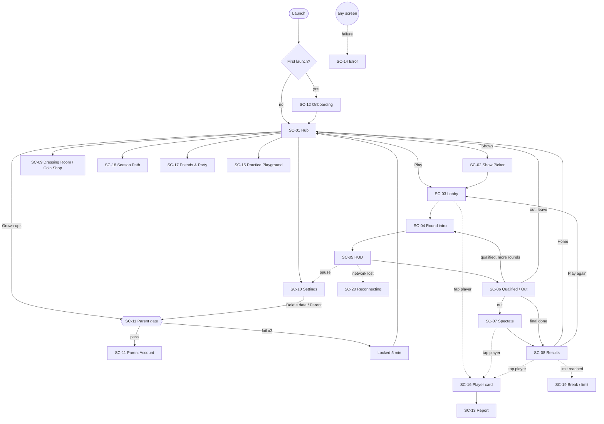
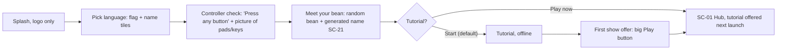
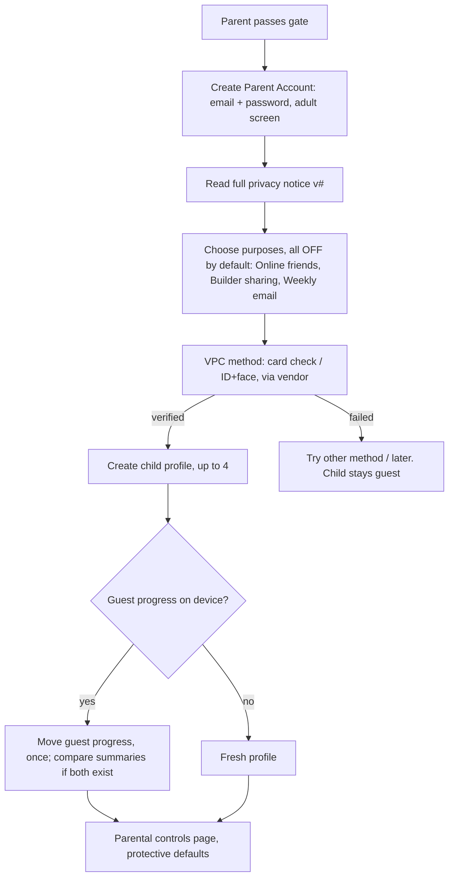
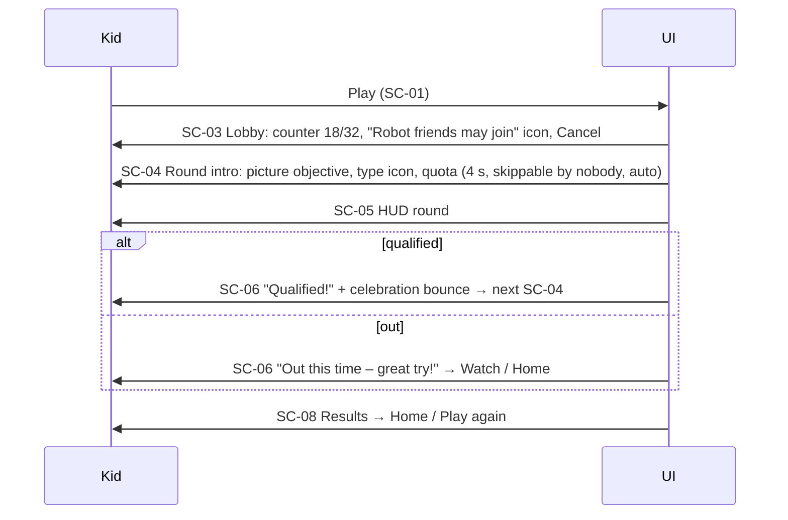

# 04 — UX Flows & UI Design (Wobblebeans)

Owner: UX/UI design (kids 6–12) · Date: 2026-10-23 · Status: Draft v1
Sources of truth: `Wobblebeans_Requirements_v3.docx`, `08-ui-ux-audio.md`, `11-child-safety-privacy.md` (in `/workspace/fallguys/`).
Scope: screen map, navigation, user flows, low-fi wireframes, HUD, kid readability, accessibility, localisation, component library.
**Imagery:** every picture, icon and bean shown here is a placeholder (`[img:...]`). Final art comes from the user's asset repo through the Chapter 12 pipeline (AD-26, UD-3).

Key constraints this design follows:
- Everyone is a child. There is no age gate and no teen or adult path; adults use the separate Parent Account (AD-01, FR-11-01).
- No free text or voice anywhere in a child profile, and no keyboard or text field (FR-11-03 AC3). Names are generated (FR-11-04).
- No purchases, ads or dark patterns (AD-12, FR-11-09, FR-11-14, FR-08-18).
- MVP platform is Windows PC: mouse, keyboard and controller, played at desk or TV distance (AD-51). Touch is designed for but ships Later.
- Original look. The reference game's pink, yellow and blue UI is not reused (AD-26).

---

## 1. Screen map

### 1.1 Screen inventory
SC-01…SC-15 come from 08 §1. **SC-16…SC-22 are new UX IDs** proposed here for screens the requirements need but do not number (see Issue UX-I3).

| ID | Screen | Requirements | Offline? |
|---|---|---|---|
| SC-01 | Main menu (hub) | 08 §1, FR-08-04 AC2 | Partial (online tiles greyed out with a cloud icon) |
| SC-02 | Show Picker | 08 §1 | No |
| SC-03 | Matchmaking / lobby | AD-17, FR-07-14 | No |
| SC-04 | Round intro | FR-08-04 | No |
| SC-05 | In-round HUD | FR-08-01, FR-08-02 | No |
| SC-06 | Qualified / Out | FR-08-03 | No |
| SC-07 | Spectate | FR-07-11, AD-36 | No |
| SC-08 | Results / victory | AD-35, FR-08-18 | No |
| SC-09 | Dressing Room + Coin Shop | FR-05-17, FR-05-10, FR-11-09 | Dressing Room yes (cached items), Shop no |
| SC-10 | Settings | FR-08-09/11/12/20, FR-04-12 | Yes |
| SC-11 | Parent gate + Parent Account (consent, controls, dashboard, data) | FR-11-02/07/08/10/12 | Gate yes, Account no |
| SC-12 | First-run onboarding + tutorial | FR-08-17, AD-44 | Yes |
| SC-13 | Report a problem | FR-11-06, FR-07-15 | No (queued) |
| SC-14 | Error / offline state | FR-08-16 | Yes |
| SC-15 | Practice Playground | FR-01-12, AD-18 | Yes |
| SC-16 | Player card (overlay: Block, Report, Add friend) | FR-07-15, FR-11-06 | No |
| SC-17 | Friends and Party | FR-07-06, AD-04 | No |
| SC-18 | Season Path | 06 | No |
| SC-19 | Break reminder / playtime limit | FR-11-15, AD-23 | Yes |
| SC-20 | Reconnecting overlay | FR-07-16 | – |
| SC-21 | Name picker (re-roll) | FR-11-04 | Yes |
| SC-22 | Kids' privacy explainer (picture-led) | FR-11-13 | Yes |

### 1.2 Navigation map



Navigation rules:
- **N1:** Every screen has one Back control in the same place (top-left), mapped to Esc / B. Back never skips the parent gate (FR-11-07 AC1).
- **N2:** The hub is at most 2 steps from any non-game screen.
- **N3:** The show flow SC-03 → SC-08 never returns to the hub between rounds (FR-08-04 AC1). After SC-08 the player goes to the hub unless they press "Play again". There is no auto re-queue (FR-08-18).
- **N4:** Settings opens as an overlay during a show and does not pause the game (FR-08-12 AC2).
- **N5:** Focus is always visible, and every screen is fully usable with controller only, keyboard only, or mouse only.

---

## 2. User flows

### 2.1 First launch (FR-08-17, AD-44, FR-11-01)

- Play starts as a **guest** at once. Nothing is asked: no name, email or age (US-11-4). Only a pseudonymous ID is sent (FR-11-01 AC2).
- Language defaults to the OS locale, and the child confirms it with one tap.

### 2.2 "Age gate" → grown-up fork (AD-01, FR-11-07)
The brief asked for an age gate. **Per AD-01 there is no age gate**: a mixed-audience gate is weaker under COPPA and the Children's Code. Instead, a "Grown-ups" button (padlock icon) on the hub and in Settings opens the parent gate. See Issue UX-I1.
```mermaid
flowchart LR
  A[Grown-ups button] --> B[Parent gate: sum in words, number-pad answer]
  B -- correct --> C{Parent Account signed in?}
  C -- no --> D[Sign in / Create (opens web via QR or in-game)]
  C -- yes --> E[Parent Account home]
  B -- wrong --> F[Try again, attempts left shown as dots]
  F -- 3rd wrong --> G[Locked 5 min, friendly picture] --> H[Back to hub]
```

### 2.3 Parent consent (FR-11-02, AD-22, FR-07-06 AC2/AC3)

- Each consent record stores method, timestamp, purposes and notice version (FR-11-02 AC3). Withdrawing consent shows "Online play will lock after this show" (11 §5).
- Adult screens can use normal text input and smaller text (≥ 24 px). Child readability rules do not apply to them, but contrast and localisation rules do.

### 2.4 Tutorial (FR-08-17, FR-01-12)
Stations in an offline island: **Move → Jump → Dive → Grab → Emote/Quick-chat → Finish arch**. Each station has an animated picture of the input, a single-word label ("Jump!"), a ghost bean demonstrating it, and a gate that opens on success. There is no fail state. After 20 s with no progress the bean demo replays. Target: 5 minutes or less (AC1). A Skip button appears only after the first completion.

### 2.5 Play a show (FR-08-04)


### 2.6 Eliminated → spectate (FR-07-11, AD-36, 08 §4)
SC-06 Out shows two big buttons: **[eye] Watch** (focused by default) and **[house] Home**. Neither has a countdown (FR-08-18). In SC-07: ◀ ▶ cycles players, with party members first (AC2). When the watched player finishes, the camera moves on after 2 s. When everyone has left, the player goes to SC-08 at round end.

### 2.7 Results (AD-35, FR-08-18)
Order: winner celebration (equipped celebration plays) → my placement → itemised rewards (XP bar, Coins and Trophy tally, counted up in under 3 s and skippable) → **Home** (default focus) and **Play again**. No streaks, no "you'll lose", no timed buttons. The break reminder or limit (SC-19) shows here, after the show only (FR-11-15 AC2).

### 2.8 Dressing Room (FR-05-17, FR-05-10, FR-11-09)
Tabs (icons + label): Colour, Pattern, Faceplate, Upper, Lower, Emote, Celebration, Banner, Title. Tapping equips at once and the bean preview reacts. Unowned items show a lock and a **"How to get it"** chip (for example "Season Path step 12"). The Coin Shop tab shows Coin prices only: no real money and no countdown or "rotating soon" timer (FR-08-18, see UX-I6).

### 2.9 Settings
Tabs: Sound, Controls, Screen, Easy-play (accessibility), Language, Help & Safety. Destructive and adult options ("Delete my data on this device", "Parent controls") sit behind the parent gate (FR-11-12).

### 2.10 Parental dashboard (FR-11-08, FR-11-10, FR-11-12)
Per-child tabs: **Activity** (30-day playtime bar chart; Trophies and Season Path), **Friends** (approve or remove; pending first), **Safety** (reports made, blocks), **Controls** (quick-chat on/off, Builder on/off, Builder sharing off, break reminder 30–120 min, daily limit off/time), **Purchases** (empty state: "No purchases. Spending is off." in MVP), **Data** (view, export JSON, delete profile). A "Data as of hh:mm" stamp shows the time (no more than 15 minutes old, FR-11-10 AC1). Controls show "Applies from the next show" (FR-11-08 AC1).

---

## 3. Low-fidelity wireframes (ASCII, 16:9, 1920×1080 reference)
Legend: `[ ]` button · `(img)` placeholder art · `◉` default focus · `▣` icon.

**SC-12a Language**
```
+--------------------------------------------------------------+
|                    (img: logo placeholder)                   |
|          [▣ flag English UK ◉]   [▣ flag English US]          |
|          [▣ flag ...R2]          [▣ flag ...R2]               |
|                         [ ✓ OK ]                             |
+--------------------------------------------------------------+
```
**SC-12b Controller check**
```
+--------------------------------------------------------------+
|        (img: gamepad)      (img: keyboard+mouse)             |
|                  "Press any button!"                         |
|           ✓ detected: Gamepad   [ ▶ Go ◉ ]                    |
+--------------------------------------------------------------+
```
**SC-21 Name picker**
```
+--------------------------------------------------------------+
| [◀]              Your name                                   |
|              (img: bean, waving)                             |
|            ┌──────────────────────┐                          |
|            │   BouncyMuffin42     │  [🎲 New name] ●●●○○      |
|            └──────────────────────┘   (5 re-rolls/day)        |
|                    [ ✓ I like it ◉ ]                          |
+--------------------------------------------------------------+
```
**SC-12c Tutorial station**
```
+--------------------------------------------------------------+
| [⏸]                                  Station ●●○○○○          |
|   ┌─────────┐                                                |
|   │(img: A  │  JUMP!                                         |
|   │ button) │                                                |
|   └─────────┘         (3D: ghost bean jumps over gap)        |
|                       (player bean)       ⇒ (gate)           |
+--------------------------------------------------------------+
```
**SC-01 Hub**
```
+--------------------------------------------------------------+
| [▣ Grown-ups]   BouncyMuffin42  ⭐Lv 7   🪙 1,250   [⚙ Settings] |
|                                                              |
|  [👕 Dressing]                                 [👥 Friends]   |
|  [🗺 Season  ]        (img: my bean, idle)     [🎯 Practice]  |
|  [🛍 Shop    ]                                               |
|                                                              |
|          [ 🎪 Shows ]        [  ▶  PLAY  ◉ ]  (large)         |
|  ☁ offline? → online tiles greyed with cloud icon            |
+--------------------------------------------------------------+
```
**SC-02 Show Picker**
```
+--------------------------------------------------------------+
| [◀]                 Pick a show                              |
|  ┌──────────────┐  ┌──────────────┐  ┌──────────────┐        |
|  │(img: show)   │  │(img) LATER   │  │(img) LATER   │        |
|  │ Main Show ◉  │  │  🔒           │  │  🔒           │        |
|  │ 👤x32  🏁🧩👑 │  │              │  │              │        |
|  └──────────────┘  └──────────────┘  └──────────────┘        |
|                         [ ▶ Play ]                           |
+--------------------------------------------------------------+
```
**SC-03 Lobby**
```
+--------------------------------------------------------------+
| [✖ Cancel]                            👤 18 / 32              |
|                (img: beans gathering)                        |
|     🤖 "Robot friends may join"  (AD-17 disclosure)           |
|     💡 Tip: (img) Dive to go fast!                            |
| [💬 Quick-chat]   party: (bean)(bean)                         |
+--------------------------------------------------------------+
```
**SC-04 Round intro**
```
+--------------------------------------------------------------+
|                    ROUND 2 of 5                              |
|        🏁 (type icon)   "Hill Hop"  (name placeholder)        |
|           (img: animated objective — reach the crown)        |
|                 ✓ 20 beans go through                        |
+--------------------------------------------------------------+
```
**SC-05 HUD**: see §4.

**SC-06 Qualified / Out**
```
+--------------------------------------------------------------+
|                                                              |
|            ✓  QUALIFIED!   (big, bouncy)                     |
|                (img: bean cheering)                          |
+--------------------------------------------------------------+
+--------------------------------------------------------------+
|        ★  Out this time – great try!                         |
|               (img: bean dizzy-happy)                        |
|        [ 👁 Watch ◉ ]        [ 🏠 Home ]                       |
+--------------------------------------------------------------+
```
**SC-07 Spectate**
```
+--------------------------------------------------------------+
| [🏠 Leave]  👁 Watching: SunnyPickle07 ⭐party   ⏱1:12  ✓14/20 |
|                                                              |
|   [◀]          (3D: followed bean)              [▶]          |
|                                                              |
| [▣ Player card]                         [💬 Quick-chat]       |
+--------------------------------------------------------------+
```
**SC-08 Results**
```
+--------------------------------------------------------------+
|              👑 WINNER: ZippyNoodle55                         |
|             (img: winner celebration)                        |
|   You: Round 4 of 5  ⭐                                        |
|   ⭐ XP  +120 ▓▓▓▓▓▓░░  🪙 +40   🏆 +1                          |
|   (tap a bean → player card)                                 |
|        [ 🏠 Home ◉ ]          [ ▶ Play again ]                 |
+--------------------------------------------------------------+
```
**SC-09 Dressing Room / Coin Shop**
```
+--------------------------------------------------------------+
| [◀]  [🎨][▦][😀][👕][👖][💃][🎉][🚩][🏷]     🪙 1,250  [🛍 Shop] |
|  ┌────┬────┬────┐                                            |
|  │ ✓  │    │ 🔒 │        (3D bean preview, rotate ⟲ ⟳)        |
|  ├────┼────┼────┤                                            |
|  │    │ 🔒 │    │        Selected: "Stripy" (placeholder)    |
|  └────┴────┴────┘        🔒 How to get it: Season step 12     |
|                          Shop: [🪙 300 Get]  (no timers)       |
+--------------------------------------------------------------+
```
**SC-10 Settings**
```
+--------------------------------------------------------------+
| [◀] [🔊Sound][🎮Controls][🖥Screen][♿Easy-play][🌐Lang][❓Help]  |
|  🔊 All      ▓▓▓▓▓▓▓░░░ 70   🔇                                 |
|  🎵 Music    ▓▓▓▓▓░░░░░ 50   🔇                                 |
|  💥 Effects  ▓▓▓▓▓▓▓▓░░ 80   🔇                                 |
|  🔘 Buttons  ▓▓▓▓▓▓░░░░ 60   🔇                                 |
|  ───────────────────────                                      |
|  [🔒 Parent controls]   [🔒 Delete my data on this device]     |
+--------------------------------------------------------------+
Easy-play tab: Text size [A][A+][A++] · Colour help [Off][Red-green P][Red-green D][Blue-yellow]
· Grab [Hold][Toggle] · Mash [Tap][Hold] · Sound pictures [On] · Shake [On/Low/Off]
· Flashes [On/Low/Off] · Speed lines [On/Low/Off] · Motion blur [Off] · FOV 60°–85° · [▶ Replay tutorial]
```
**SC-11 Parent gate**
```
+--------------------------------------------------------------+
| [◀]           For grown-ups                                  |
|   What is  thirty-four  plus  twenty-seven ?                 |
|            ┌─────┐                                           |
|            │ 6 1 │      [1][2][3]                            |
|            └─────┘      [4][5][6]                            |
|   attempts ●●○          [7][8][9]                            |
|                         [⌫][0][✓]                            |
+--------------------------------------------------------------+
```
**SC-11 Parent dashboard**
```
+--------------------------------------------------------------+
| Parent Account ▾ (child: BouncyMuffin42 ▾)   Data as of 10:05 |
| [Activity][Friends (2)][Safety][Controls][Purchases][Data]    |
|  Playtime last 30 days  ▁▃▅▂▇▁▃ ...                           |
|  Friends pending: SunnyPickle07  [Approve] [Decline]          |
|  Controls: Quick-chat [On]  Builder [Off]  Sharing [Off]      |
|            Break reminder [60 min ▾]   Daily limit [Off ▾]    |
|            ⓘ Changes apply from the next show                 |
|  Data: [View] [Export JSON] [Delete profile]                  |
+--------------------------------------------------------------+
```
**SC-13 Report (≤ 2 interactions from SC-16)**
```
SC-16 Player card                    SC-13 Report reasons (1 tap sends)
+-----------------------------+      +-----------------------------------+
| (bean) SunnyPickle07        |      | What happened?                    |
| [👥 Add friend]              |  →   | [😠 Being mean] [🃏 Cheating]       |
| [🚫 Block]  [🚩 Report]      |      | [🏷 Bad name/picture] [😢 Upset me] |
+-----------------------------+      +-----------------------------------+
Confirmation: "Thank you! You did the right thing." · "Tell a grown-up you trust." · auto-block notice · [✓ OK]
```
**SC-14 Error**
```
+--------------------------------------------------------------+
|                    (img: bean holding unplugged cable)       |
|                 No internet right now.                       |
|      [ 🔁 Try again ◉ ]      [ 🎯 Practice ]                   |
|                                          code: NET-01        |
+--------------------------------------------------------------+
```
**SC-15 Practice Playground**: same HUD as SC-05, with [🏠 Leave] and a "Practice: no stars or coins" badge (FR-01-12 AC2).
**SC-17 Friends & Party**
```
+--------------------------------------------------------------+
| [◀] Friends                                                  |
|  (bean) SunnyPickle07   🟢 online   [➕ Invite to party]        |
|  (bean) ZippyNoodle55   ⚪ away                                |
|  ⏳ Waiting for grown-up OK: 1                                |
|  [👥 Add friend → shows friend code; parent approves]         |
|  (no consent yet → padlock card: "Ask a grown-up to turn on   |
|   friends")                                                  |
+--------------------------------------------------------------+
```
**SC-18 Season Path**: horizontal track of reward nodes (img), the current step highlighted, ◀ ▶ scrolling, and node detail. No expiry countdowns. The season end date appears in Settings → Help only (FR-08-18, UX-I6).
**SC-19 Break / limit**
```
+--------------------------------------------------------------+
|        (img: bean stretching)   Time for a little break!     |
|                 [ 🏠 OK ◉ ]                                    |
| (limit version: "That's playtime for today. See you soon!")  |
+--------------------------------------------------------------+
```
**SC-20 Reconnecting**: dimmed overlay, spinner bean, "Getting you back in…". After 61 s it shows SC-14 with "Disconnected – you can play again any time" (FR-07-16 AC2).
**SC-22 Kids' privacy explainer**: 3 picture cards: "We keep your game safe", "No chatting with strangers", "A grown-up says yes to friends". Shown just in time before adding a friend (FR-11-13).

---

## 4. HUD layout (SC-05) — FR-08-01, FR-08-02, FR-08-12 AC4

```
+------------------------------------------------------------------+
|5% safe area                                                      |
| ┌─────────────────────┐                     ┌──────────────────┐ |
| │🏁 Reach the crown!   │                     │ ⏱ 1:30  ✓ 12/20  │ |
| └─────────────────────┘                     └──────────────────┘ |
|        [! Watch out — tail!]  (warning, upper-centre)            |
|  🔊◀ sound-picture (directional, edge)                           |
|                                                                  |
|                       (player bean — clear zone)                 |
|                                                                  |
|                                                [💬] quick-chat   |
+------------------------------------------------------------------+
```
- **Top-left:** objective (icon + ≤ 4 words). **Top-right:** timer and/or qualified count. Both are in the top 50%, inside the 5% safe area, and are tested at 16:9, 21:9 and 4:3 (FR-08-01 AC1). On 21:9 the HUD anchors to a 16:9 centre column.
- **Bean clear zone:** the central 40% × 50% has no HUD.
- **Warning cue:** "!" plus enlarged text, appearing on the next frame and flashing no more than 3 times per second (FR-08-02, NFR-10-19).
- **Team rounds:** a team badge top-centre with colour + shape + pattern (▲ ● ■ ★) (FR-08-11).
- **Sound pictures:** edge-anchored icons for gameplay-relevant audio such as a falling tile or a horn (FR-08-12 AC4, FR-08-08 AC2).
- HUD text is at least 32 px at 1080p (FR-08-13).

---

## 5. Kid readability rules
| # | Rule | Source |
|---|---|---|
| R1 | **Icon-first:** every action button = icon + word. Icon on the left (mirrored for RTL later). | FR-08-19 |
| R2 | **Minimal text:** ≤ 8 words for 95% of strings, with a goal of ≤ 4 on buttons. Year 2 / Grade 1–2 reading level. | FR-08-19 AC1 |
| R3 | **Font sizes at 1080p:** HUD ≥ 32 px, body ≥ 28 px, secondary ≥ 24 px, headings 48–72 px. Scale linearly with vertical resolution. | FR-08-13, AD-49 |
| R4 | **Typeface:** rounded humanist sans with single-storey a/g, large x-height and wide tracking. No all-caps body text (caps allowed for 1–2 word celebrations). Must support Latin-ext, Cyrillic and CJK fallback. | FR-08-14 |
| R5 | **Target sizes:** PC (MVP) clickable targets ≥ 64 × 64 px at 1080p, primary actions ≥ 96 px tall, ≥ 16 px gap. Touch (Later) ≥ 48 × 48 dp, primary ≥ 64 dp. Controller: focus ring ≥ 4 px, 3:1 contrast. | UX-I4 (AD-51) |
| R6 | **One primary action per screen**, focused by default and always the protective or safe choice. | FR-08-18 AC3 |
| R7 | **Positive wording only;** banned-word lint applies. | FR-08-03 |
| R8 | **No urgency:** no countdowns on choices or offers, no "hurry"/"last chance". | FR-08-18 |
| R9 | **Pictures explain rules** (round intro, report reasons, privacy). | FR-08-19, FR-11-06, FR-11-13 |
| R10 | **Numbers:** use digits and icons (🪙 40) instead of words. | FR-08-19 |

---

## 6. Accessibility
| Area | Design | Source |
|---|---|---|
| Contrast | Text ≥ 4.5:1; large text, icons, hazard outlines and walkable edges ≥ 3:1. Tokens are checked in CI. | FR-08-06 |
| Colour-blind | Never hue alone: team = colour + shape + pattern, drop tiles = colour + crack pattern + icon, rarity = colour + gem shape + word. 3 presets (protan, deutan, tritan) that remap tokens. | FR-08-11 |
| Text size | 100 / 125 / 150%. Layouts use auto-layout with wrap, never fixed-width text boxes. 0 clipping at 150% (and at +40% pseudo-loc combined, see UX-I5). | FR-08-12 AC3, FR-08-14 AC2 |
| Reduced motion | Motion blur off by default. Shake, flashes and speed lines each On/Low/Off. FOV 60–85°. "Reduce motion" master switch also shortens UI tweens to fades of 150 ms or less. Flashing never exceeds 3 Hz. | FR-08-20, NFR-10-19 |
| Audio → visual | Sound pictures, captions for UI sounds, mute per channel. | FR-08-12 AC4, FR-08-09 |
| Motor | Grab toggle, hold-to-mash, full rebinding (swap on conflict), no timed UI inputs. | FR-08-12, FR-04-12 |
| Cognitive | Consistent layout, one primary action, replayable tutorial, Practice Playground. | FR-08-17, FR-01-12 |
| Mid-show | Settings overlay without pausing or disconnecting. | FR-08-12 AC2 |
| Screen reader | Not required in MVP. All components expose a label string for future OS TTS (see UX-I7). | — |

---

## 7. Localisation rules (FR-08-14, AD-27)
- **L1:** MVP ships en-GB and en-US. US/UK differences use separate keys (Colour/Color, Favourite/Favorite).
- **L2:** No hard-coded strings. Every key has a context note, max length, screenshot reference and audience (child or adult).
- **L3:** Design for +40% expansion. Buttons grow horizontally first, then wrap to 2 lines, then shrink to the minimum font size, and never truncate. Pseudo-loc build uses accents, brackets and +40%.
- **L4:** Fonts cover Latin-ext, Cyrillic and CJK (glyph fallback chain). Leave line-height headroom for diacritics (≥ 1.3).
- **L5:** Layouts are mirror-ready (start/end, not left/right) for possible RTL later. Directional icons have mirrored variants.
- **L6:** Dates and times show in local time; resets are stored in UTC (AD-33). Use locale number formats (1,250 / 1 250).
- **L7:** The banned-word list, urgency list, quick-chat phrases and name word lists are maintained per language and signed off (FR-08-03, FR-08-18, FR-07-14, FR-11-05).
- **L8:** No text baked into images. Placeholder art must not carry words.
- **L9:** No string concatenation. Use ICU MessageFormat with plurals and gender-neutral wording.

---

## 8. UI component library spec

### 8.1 Design tokens (original palette, AD-26; final values come once the asset repo lands)
| Token | Placeholder | Use |
|---|---|---|
| `color.bg.sky` | #E8F6FF | Screen background |
| `color.surface` | #FFFFFF | Cards and panels |
| `color.ink` | #1B2340 | Text (≥ 12:1 on surface) |
| `color.primary` | #00A88F (teal) | Primary button |
| `color.secondary` | #6B4BD8 (violet) | Secondary button |
| `color.accent` | #FF8A1F (tangerine) | Rewards, Coins |
| `color.success` | #2E9E44 + ✓ | Qualified |
| `color.warn` | #D9480F + ! | Warnings |
| `color.team.{a,b,c,d}` | teal ▲, tangerine ●, violet ■, lime ★ | Team identity |
| `radius.{s,m,l}` | 12 / 20 / 32 px | Corners |
| `space.unit` | 8 px | Spacing grid |
| `type.{hud,body,secondary,h1}` | 32 / 28 / 24 / 64 px | Text sizes |
| `motion.{fast,base}` | 150 / 250 ms; reduced = fade only | Animation |
| `focus.ring` | 4 px `color.ink` + 2 px white halo | Focus |

### 8.2 Components
| Component | Variants / states | Rules |
|---|---|---|
| **BigButton** | primary, secondary, quiet; default, focus, pressed, disabled (with reason icon) | Icon + label; ≥ 96 px high; pressed squish 0.95 + click SFX |
| **IconButton** | round 64 px | Label shown as tooltip on focus; must be in label table |
| **Tile/Card** | show card, item tile (owned ✓, equipped ★, locked 🔒), reward node | Ownership state shown with an icon, never colour alone |
| **TabBar** | icon tabs, LB/RB or Q/E to switch | Max 9 tabs; active tab = underline + fill |
| **Slider** | 0–100, mute toggle | Step 5 (fine step 1 with modifier), applies within 100 ms |
| **Segmented / Toggle** | 2–4 options | Default = most protective |
| **Counter/Badge** | 👤 18/32, 🪙, ⭐ level | Digits + icon |
| **HUD panel** | objective, progress, warning, team badge, sound picture | Anchors per §4 |
| **Toast** | info only, ≤ 3 s, never during a round | No reward pop-ups during play (FR-08-18) |
| **Modal** | confirm, error (SC-14 pattern), break | One primary action + optional Back; reference code slot |
| **PlayerCard** | overlay | Add friend / Block / Report; ≤ 2 interactions to report or block |
| **QuickChatWheel** | 8 slots, up to 16 phrases | Icon + phrase; rate-limited; hidden from blocked players |
| **NumberPad** | parent gate only | Digits only, not a text keyboard (UX-I2) |
| **BeanPreview** | idle, emote, celebration, rotate | 360° rotation with mouse, stick or keys |
| **ProgressTrack** | XP bar, season path | No expiry timers |
| **EmptyState** | icon + 1 line + 1 action | e.g. Purchases "Spending is off" |
| **FocusRing** | global | Always visible on controller and keyboard |

Every component ships with: a token-only style, an a11y label key, 150% text and +40% loc stories, colour-blind preset stories, and reduced-motion behaviour.

---

## 9. Traceability matrix
| Requirement | Where addressed |
|---|---|
| FR-08-01 HUD | §4 |
| FR-08-02 Warning | §4 |
| FR-08-03 Wording | §3 SC-06, R7, L7 |
| FR-08-04 Round flow | §1.2 N3, §2.5 |
| FR-07-11 / AD-36 Spectate | §2.6, SC-07 |
| FR-08-06 Contrast/tokens | §6, §8.1 |
| FR-08-08 / FR-08-09 Audio | §6, SC-10 |
| FR-08-11 Colour-blind | §4, §6 |
| FR-08-12 Accessibility | §6, SC-10 |
| FR-08-13 Text size / AD-49 | R3, §8.1 |
| FR-08-14 Localisation / AD-27 | §7 |
| FR-08-16 Errors | SC-14, SC-20 |
| FR-08-17 / AD-44 Onboarding | §2.1, §2.4 |
| FR-08-18 Dark patterns | R6, R8, §2.6–2.8, UX-I6 |
| FR-08-19 Kid language | R1, R2, R9 |
| FR-08-20 Motion | §6 |
| FR-04-12 Rebinding | §6 |
| FR-05-17 / FR-05-10 Dressing Room | §2.8, SC-09 |
| FR-01-12 / AD-18 Practice | SC-15 |
| FR-07-06 / AD-04 Friends | SC-17, §2.3 |
| FR-07-14 Quick-chat | QuickChatWheel |
| FR-07-15 Block | SC-16 |
| FR-07-16 Reconnect | SC-20 |
| AD-17 Bot disclosure | SC-03 |
| AD-35 Celebration | §2.7 |
| AD-01 No age gate | §2.2 |
| FR-11-01 / US-11-4 Guest | §2.1 |
| FR-11-02 / AD-22 Consent | §2.3 |
| FR-11-03 No text/voice | Global constraint, UX-I2 |
| FR-11-04 Names | SC-21 |
| FR-11-06 Reporting | SC-13 |
| FR-11-07 Parent gate | §2.2, SC-11 |
| FR-11-08 / FR-11-10 Controls & dashboard | §2.10 |
| FR-11-09 / AD-12 No spending | SC-09, Purchases empty state |
| FR-11-11 Privacy defaults | §2.3 P4, R6 |
| FR-11-12 Data deletion | SC-10, §2.10 |
| FR-11-13 Privacy notices | SC-22, §2.3 |
| FR-11-15 / AD-23 Wellbeing | SC-19 |
| FR-11-19 No marketing notifications | No notification UI to children |
| AD-26 Original palette | §8.1 |
| AD-51 PC-only | R5, UX-I4 |

---

## 10. Requirement issues found and resolutions
| ID | Issue | Resolution (UX decision; confirm with analyst) |
|---|---|---|
| **UX-I1** | The brief asks for an "age gate" flow, but AD-01 / FR-11-01 rule out any age gate: everyone is a child. | **No age gate.** Replaced by the "Grown-ups" button → parent gate → Parent Account (§2.2). The age question is never asked of the child. |
| **UX-I2** | FR-11-07 example says the adult must "type the answer", but FR-11-03 AC3 says a child profile has **no on-screen keyboard or text field anywhere**. Also, the kids "counting answers ≤ 20" AC (in the docx) must not be confused with the parent gate. | The gate uses a **digits-only NumberPad component** (not a text field and no letters), and the sum is written in words with an answer of 21–99, harder for 6–8s. Propose amending FR-11-03 AC3 to "no free-text field; the parent-gate numeric pad is excepted". Parent Account sign-in and creation open in a separate adult context (web via QR, or an adult-mode screen after the gate). |
| **UX-I3** | The screen inventory lacks screens the requirements need: player card, friends/party, Season Path, break/limit, reconnect, name picker, kids' privacy explainer. The parental dashboard is folded into SC-11. | Added **SC-16…SC-22** as UX IDs (§1.1). Propose adding them to 08 §1. |
| **UX-I4** | The brief asks for touch-target sizes, but MVP is PC-only (AD-51). There is no requirement for target size at all. | Defined PC targets (≥ 64 px, primary ≥ 96 px at 1080p) and touch targets for Later (≥ 48 dp) in R5. Propose a new NFR. |
| **UX-I5** | FR-08-12 AC3 (150% text) and FR-08-14 AC2 (+40% pseudo-loc) are tested separately. Together they can break layouts, and the combination is untested. | Design and test the **combined worst case** (150% + 40%). Propose adding it to T-FR-08-14. |
| **UX-I6** | FR-08-18 bans countdowns on offers, but the Coin Shop and Season Path imply rotation and season end. It is unclear whether "shop refreshes in 3 h" or "season ends in 5 days" is allowed. | No countdown in the Shop or Season Path. The season end date appears as a static date only in Help. Shop items do not show rotation timers. Propose stating this in FR-08-18. |
| **UX-I7** | Screen-reader / TTS support is not mentioned. It matters for pre-readers (6-year-olds) and visually impaired players. | Out of MVP scope, but every component carries a label key so OS TTS or narrated UI can be added. Suggest an open question for R2 ("read-aloud button"). |
| **UX-I8** | FR-01-12 refers to "the tutorial stations of **FR-08-16**", but the tutorial is FR-08-17 (FR-08-16 is errors). | Treated as a typo for **FR-08-17**. Fix in the docx. |
| **UX-I9** | Round intro (SC-04) and lobby timers could read as "countdowns on choices". | They are not choices. Countdowns appear only on non-interactive game-state screens. Choice screens (Watch/Home, Play again) never have timers. |
| **UX-I10** | Adult-facing screens (consent, dashboard) have no stated readability or contrast standard. Child rules (≤ 8 words, 28 px) do not fit legal text. | Adult screens: WCAG 2.2 AA, body ≥ 24 px at 1080p, plain-English notices. Child rules exempted. Propose noting this in FR-08-19's scope. |

Open dependency: the final palette, icon set, bean and show imagery wait for the user's asset repository (UD-3). All `(img)` slots are placeholders.
