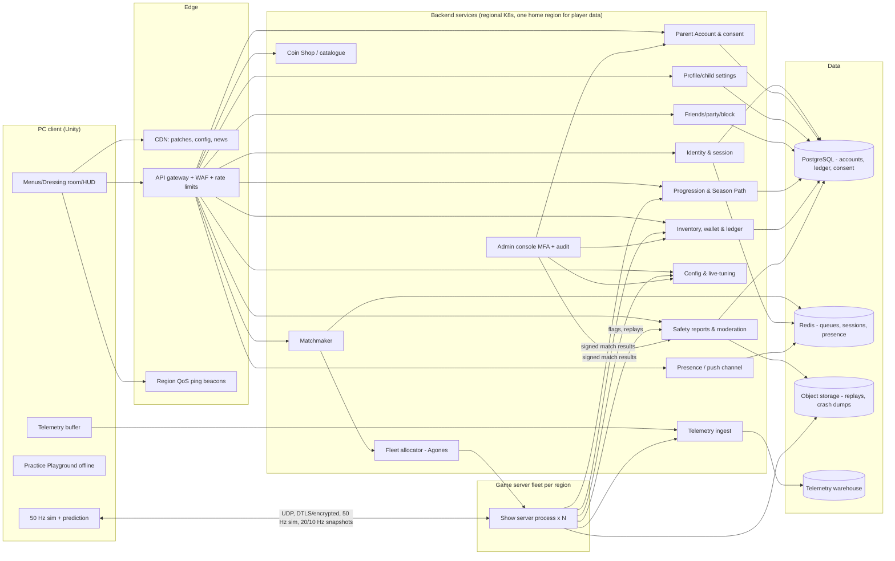
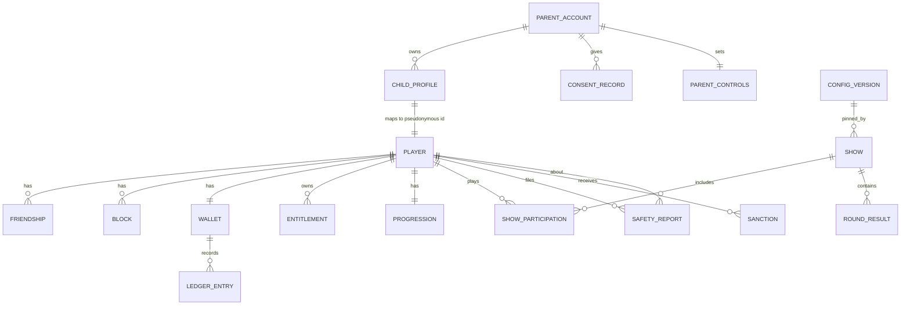

# 08 — Technical Architecture Design: Wobblebeans

*Owner: technical/systems architecture. Date: 23 Oct 2026. Sources: `Wobblebeans_Requirements_v3.docx` (v3), `gapfill-D-netcode-servers.md` (D-xx), `10-platform-nfr-legal.md` (NFR-10-xx). Every number here is a **design estimate, not confirmed from Fall Guys**, unless it cites a requirement. Where requirements fix a value, that value is used and not changed here.*

## 0. Scope and fixed decisions inherited from the requirements
| Fixed input | Source |
|---|---|
| Kids 6–12; COPPA, UK Children's Code and GDPR-K apply; no free text or voice; parent consent | UD-1, FR-11-01..19, NFR-10-08/09 |
| MVP platform: Windows PC; other platforms later | AD-51, NFR-10-01 |
| 32-player Main Show (config 8–40) | AD-05, NFR-10-03, D-12 |
| One shared 50 Hz simulation step on client and server | AD-06, D-01 |
| Server-authoritative results, client-predicted own movement | D-03, D-04, NFR-10-05 |
| Server step P99 ≤ 9 ms, 2 shows per vCPU | AD-32, NFR-10-04 |
| Default planning CCU F = 10,000; load test to 10×F | D-16, Q-C3, NFR-10-06 |
| No real-money purchases in MVP; Coins only; no premium currency | AD-12, FR-05-14, FR-06-05 |
| All tuning values are data, rollback ≤ 5 min | NFR-10-20 |
| First-party, pseudonymous telemetry only | NFR-10-12, AD-21 |
| "MiniMax" meaning unresolved | Q-A1, NFR-10-02 |

## 1. Engine choice (NFR-10-02)
| Criterion | Unity 6 | Unreal Engine 5 | Godot 4 |
|---|---|---|---|
| Networked physics for 32 ragdolls | PhysX via Rigidbody; NGO server-authoritative rigidbodies; mature third-party netcode (Photon Fusion, Fish-Net); the reference game shipped on Unity + modified UNet | Chaos physics; good replication framework; networked physics prediction is newer and harder to tune; physics-driven characters are heavier | Jolt/Godot Physics; high-level multiplayer API is basic; we would build prediction and rollback ourselves |
| Headless dedicated server | Linux dedicated-server build target; mature | Dedicated server needs a source build; heavier process (memory) | Headless export is easy and light |
| Cartoon art at 60 fps on GTX 960 class (NFR-10-04) | URP fits well | Possible with scaled-down settings; Nanite/Lumen not usable at min spec | Fine, smaller rendering ecosystem |
| Later ports (console, Switch, mobile; AD-51) | Strongest mobile and Switch story | Good on console, weaker on low-end mobile/Switch | Console ports go through third parties |
| Team hiring, kid-studio tooling, cost | Large talent pool; runtime fee was cancelled (check the current licence) | 5% royalty above threshold; C++ hiring | MIT licence, smallest talent pool |
| Fit to gapfill-A/D (Unity-style fixedDeltaTime) | Direct | Needs translation | Needs translation |

**Recommendation: Unity 6 LTS** (URP, Linux headless server build) with a **netcode decision spike at M0** between Unity Netcode for GameObjects (NGO) and Photon Fusion 2 (server mode) or a similar library. Pick the one that passes the ragdoll prototype (§13, R-01). Godot is the fallback if licence risk dominates. Unreal is not recommended for this scope.
**"MiniMax" (Q-A1):** still unresolved. Plausible meanings: (a) an AI vendor (MiniMax) used for content, voice or asset generation; (b) a typo or internal name for a tool or engine; (c) the minimax algorithm (game AI). None changes the runtime architecture. If it means (a), it falls under the asset-provenance rules (FR-12-07) and must **never** receive child data (FR-11-14, NFR-10-12). **Action:** product owner answers Q-A1 before the M0 engine decision record is signed off (NFR-10-02 AC1).

## 2. System context and client/server architecture (FR-07-12)

Principles:
1. **Dedicated, server-authoritative show servers.** One headless process runs one show (D-15).
2. **Stateless HTTP/gRPC microservices behind one gateway.** Keep the service count small at MVP (a modular monolith with the listed modules is acceptable; split later).
3. **Player PII lives only in the Parent Account/consent store.** Every other service uses a pseudonymous `player_id` (FR-11-11, NFR-10-12).
4. **Game servers never write player data directly.** They post a signed `MatchResult` that Progression and Inventory apply idempotently.

## 3. Netcode model (D-01..D-10, NFR-10-05, FR-03-02, FR-03-07, FR-04-xx)
| Topic | Design | Trace |
|---|---|---|
| Simulation | Fixed 50 Hz step on both sides; render decoupled. PhysX is not deterministic → **snapshot state sync**, not lockstep | AD-06, D-01 |
| Authority | Server owns qualification, timer, scores, grabs, obstacles, tiles, respawn, fake-path layouts. Own bean is predicted and validated by the server | D-03, FR-02-02 AC4, NFR-10-05 AC3 |
| Input | C→S at 25 Hz; each packet carries the last 6 steps (redundant), sequence plus client tick | D-02 |
| Snapshots | S→C 20 Hz near/on-screen, 10 Hz far (interest management); delta-compressed against last acked; 16-bit quantised positions, smallest-three quaternions, ragdoll as root + 3–5 key bones (not every bone) | D-02, D-07 |
| Prediction | Own move/jump/dive predicted; 1 s ring buffer; >0.3 m → rewind and replay; 0.05–0.3 m → smoothed over 100–200 ms; grabs/knockbacks from others are **not** predicted | D-04 |
| Remote entities | Interpolated at 100 ms (adaptive 80–200 ms); extrapolate ≤150 ms then freeze | D-05 |
| Obstacles | Kinematic movers driven by **server time** (synced clock, NTP-style offset estimate); clients sample the same timeline → phase error ≤50 ms P95 | FR-03-02 AC1 |
| Events | Reliable ordered channel for tile removal, eliminations, round state; tile hidden ≤100 ms after event | FR-03-07 AC2 |
| Lag comp | Rewind other beans' hitboxes for grab/dive-hit start only, cap 200 ms | D-06 |
| Ties | Sub-tick timestamp from the server-side contact solver; equal → all win | FR-01-05 AC2, AD-10 |
| Bandwidth | ≤64 kbps avg / 128 peak down, ≤16 kbps up; ≤2 Mbps per show | D-07 |
| Latency | Target ≤80 ms, playable ≤150 ms, MM excludes >200 ms | D-08, D-14 |
| Reconnect | 60 s, max 2 per show, reconnect token bound to `player_id` + `show_id` | D-09, FR-07-16 |
| Transport | UDP with encryption + authentication (DTLS or the netcode library's AEAD); connect token issued by the allocator (signed, 30 s TTL) | NFR-10-16 |
| Spectating | Eliminated players receive a spectator snapshot stream (one followed bean at 20 Hz, others at 10 Hz) | FR-07-11 |

## 4. Game server lifecycle (FR-01-02, FR-01-05, D-09..D-12, AD-17)
```mermaid
stateDiagram-v2
  [*] --> Warm: Agones Ready (pre-warmed buffer)
  Warm --> Allocated: Matchmaker allocates (show config + roster + tokens)
  Allocated --> Loading: players connect with tokens (≤20 s window)
  Loading --> RoundIntro: all connected or timeout (missing = no-show)
  RoundIntro --> Countdown --> Playing
  Playing --> RoundResults: qualify/eliminate rules met or timer
  RoundResults --> RoundIntro: next level chosen (AD-29 algorithm)
  RoundResults --> Final
  Final --> ShowEnd
  Playing --> ShowEnd: only bots left (AD-17) / all humans left
  ShowEnd --> Reporting: signed MatchResult -> Progression/Inventory (ack ≤5 s, FR-01-09 AC1)
  Reporting --> Shutdown: replay upload if flagged, telemetry flush
  Shutdown --> [*]: process exits (no reuse - clean state)
```
- **Pre-warm buffer:** 10% of peak plus 50 Ready servers per region; scale-up from 10% to 100% in ≤15 min (D-16).
- **Config pinning:** a show reads the config version that was live when it was allocated. A level disabled ≥60 s before show start is never chosen (FR-01-03 AC5).
- **Crash handling:** if a server crashes, a watchdog reports `ShowAborted`. Players get XP/Coins for the rounds they finished (rounds are checkpointed to Redis after each round) and return to the menu.
- **Bots:** run in-process, ≤12 per show, casual only, ~0.1 ms/bot/step (D-11).
- **Server-side drain:** on deploy, servers in `Allocated` state finish; new allocations go to the new fleet version.

## 5. Backend services
| Service | Responsibilities | Key requirements |
|---|---|---|
| Identity & session | Device/platform login (Steam or Epic on PC, Q-C1), session JWT (15 min) + refresh, reconnect tokens, login queue at >80% capacity, kill switch on account creation | FR-07-06, D-16, NFR-10-06 |
| Parent Account & consent | Parent email + verifiable parental consent (VPC, e.g. card check or ID check through a certified vendor such as KWS/PRIVO/Veratad; vendor choice open); parent gate; controls (play-time limits, friends on/off, quick-chat on/off, spending lock); dashboard; data export/deletion; consent record kept for life of account +3 years | FR-11-02, 07, 08, 09, 10, 12, NFR-10-21 |
| Profile | Child profile with generated name (from a curated word list; not searchable), cosmetics loadout, settings (private by default) | FR-11-04, FR-11-11, FR-05-17 |
| Social | Friend codes (parent-approved), party (≤4), block/mute, presence, quick-chat preset IDs only | FR-07-03, 07, 14, 15, FR-11-03 |
| Matchmaker | Queue tickets, party atomicity, D-12 fill steps, region QoS, loose MMR bands, bot backfill decision, ≥2,000 players/s | FR-01-02, D-11..D-14, FR-07-02 |
| Fleet allocator | Agones (or GameLift/Edgegap) allocation, autoscaler, multi-cluster per region | D-15, D-16 |
| Progression | XP and level, Season Path (free track), challenges, Trophies; applies MatchResult idempotently | FR-06-01, 02, 07, 13, FR-09-19 |
| Inventory & wallet | Append-only Coin ledger, entitlements, Coin Shop purchases, grants/rollback by admin with audit | FR-06-05, 06, 19, FR-05-10, 11 |
| Config & live-tuning | Versioned, schema-validated config bundles; shows, levels, weights, physics values, kill switches, News Board | NFR-10-20, FR-01-03 AC5, FR-09-26 |
| Telemetry | Event ingest (batched HTTPS), schema registry with PII lint, warehouse, dashboards and alerts | NFR-10-12, D-19 |
| Moderation | Child-friendly reports (category picker, no free text), report queue, sanctions, anti-cheat flags, replay review, SLA tracking | FR-11-06, FR-11-17, NFR-10-13 |
| Admin console | SSO + MFA, RBAC, immutable audit log | NFR-10-16, FR-06-19 |
| Data lifecycle jobs | Daily retention deletion, export packages, account deletion cascade | NFR-10-21, FR-11-12 |

## 6. Data model (core entities)

| Entity | Key fields | Notes |
|---|---|---|
| parent_account | id, email (encrypted), country, created_at, vpc_method, status | Only table with direct PII; field-level encryption; separate schema and keys |
| consent_record | id, parent_id, child_id, scope, method, vendor_ref, granted_at, revoked_at | Append-only; kept life + 3 years |
| parent_controls | parent_id, child_id, daily_minutes, friends_enabled, quickchat_enabled, coin_shop_enabled | FR-11-08/09/15 |
| child_profile | id, parent_id, birth_year (not date), generated_name_id, locale | Minimum data (FR-11-01) |
| player | player_id (UUIDv7), child_profile_id, platform_link_hash, mmr_mu, mmr_sigma, created_at | The pseudonymous id used everywhere else |
| friendship / block | player_a, player_b, state, approved_by_parent_at | |
| wallet / ledger_entry | ledger: id, player_id, delta, reason, source_ref (show_id/admin_id), idempotency_key UNIQUE, balance_after | Balance = sum of the ledger; never updated in place |
| entitlement | player_id, item_id, source, granted_at, revoked_at | |
| progression | player_id, season_id, xp, level, path_tier, trophies, challenge_state JSONB | |
| show / round_result | show_id, config_version, region, server_build, started/ended; per-round qualified/eliminated, reason | Results kept as aggregates |
| safety_report / sanction | reporter, subject, category, show_id, replay_ref, state, SLA timestamps | Retained 1 year |
| config_version | id, bundle hash, author, approved_by, schema_version, activated_at | Immutable |
| telemetry_event (warehouse) | event_name, player_pid (rotating salted hash), session_id, ts, payload | 90 days raw, 2 years aggregates; no IP stored (coarse region only) |

## 7. API list (gateway, HTTPS/JSON or gRPC-web; all need a session token unless marked)
| Area | Endpoints |
|---|---|
| Auth | `POST /v1/auth/platform-login` · `POST /v1/auth/refresh` · `POST /v1/auth/logout` · `GET /v1/auth/queue-status` (no auth) |
| Parent (parent token, parent gate) | `POST /v1/parent/register` · `POST /v1/parent/consent/start` · `POST /v1/parent/consent/callback` (vendor, signed) · `GET/PUT /v1/parent/children/{id}/controls` · `GET /v1/parent/dashboard` · `POST /v1/parent/children/{id}/export` · `DELETE /v1/parent/children/{id}` · `POST /v1/parent/consent/revoke` |
| Profile | `GET /v1/me` · `PUT /v1/me/loadout` · `POST /v1/me/name/reroll` · `GET /v1/names/options` |
| Social | `GET /v1/friends` · `POST /v1/friends/code` · `POST /v1/friends/requests` (parent-approved) · `POST /v1/blocks` · `DELETE /v1/blocks/{id}` · `POST /v1/party` · `POST /v1/party/{id}/invite` · `POST /v1/party/{id}/leave` |
| Matchmaking | `GET /v1/shows` (available shows) · `POST /v1/mm/tickets` · `DELETE /v1/mm/tickets/{id}` · `GET /v1/mm/tickets/{id}` (or push) → returns `{host, port, connect_token}` · `POST /v1/mm/reconnect` |
| Progression | `GET /v1/progression` · `GET /v1/season/current` · `POST /v1/challenges/{id}/claim` |
| Inventory/shop | `GET /v1/wallet` · `GET /v1/inventory` · `GET /v1/shop/catalogue` · `POST /v1/shop/purchase` (Coins only, idempotency key) |
| Config | `GET /v1/config/client?version=` (CDN-cached, signed) · `GET /v1/news` |
| Safety | `POST /v1/reports` (category enum + show_id + subject) · `GET /v1/reports/mine` |
| Telemetry | `POST /v1/telemetry/batch` (schema-validated) |
| Internal (mTLS, service accounts) | `POST /internal/match-results` (signed by server key) · `POST /internal/anticheat/flags` · `POST /internal/fleet/allocate` · `GET /internal/config/server/{version}` |
| Admin (SSO+MFA, audited) | `POST /admin/config/activate` · `POST /admin/config/rollback` · `POST /admin/killswitch` · `POST /admin/wallet/grant` · `POST /admin/wallet/rollback` · `GET/POST /admin/moderation/queue` · `POST /admin/sanctions` |
| Game protocol (UDP) | `Connect(token)` · `Input[seq, ticks×6]` · `Snapshot[delta]` · `ReliableEvent{RoundState, Eliminated, TileRemoved, Score, QuickChat(id), Emote(id)}` · `Ack` · `Ping` |

## 8. Hosting and scaling (default F = 10,000 CCU; D-15, D-16, NFR-10-06)
| Item | Sizing |
|---|---|
| Shows at 10k CCU | ≈313 shows of 32 → ≈157 vCPU at 2 shows/vCPU → ~10 × 16-vCPU compute-optimised hosts across 4 regions (EU-W, EU-C, NA-E, NA-W; AD-39), plus a 30% buffer → ~14 hosts |
| Memory | ~400 MB per process × 32 per host ≈ 13 GB → use 32 GB hosts |
| Egress | ≈0.63 Gbps (≈$14/h) — larger than compute (≈$6.3/h); see issue I-04 |
| Load test target | 10×F = 100k CCU for 1 h (NFR-10-06 AC1) → ~3,130 shows, ~1,570 vCPU burst; uses cloud burst capacity |
| Fleet | Agones on managed Kubernetes (GKE/EKS) per region, game-server node pools without autoscaler eviction; optional bare-metal baseline + cloud burst once the forecast (Q-C3) exists |
| Backend | Stateless pods with HPA; PostgreSQL primary in one home region (EU, for UK/GDPR) with a read replica and PITR (RPO ≤15 min, RTO ≤4 h; NFR-10-17); Redis cluster per region for queues and sessions |
| Edge | CDN for patches/config; WAF + rate limit at the gateway; login queue at >80% auth capacity |
| Availability | 99.5% monthly (NFR-10-17); multi-AZ; game regions fail independently; MM re-routes to the next region ≤150 ms |
| Data residency | Child PII stored in one region (EU/UK); US players' PII handling is set by the DPIA (NFR-11-01, Q-C2) |

## 9. Security and anti-cheat (NFR-10-13, NFR-10-16, D-18, AD-09)
**Security baseline:**
- TLS 1.2+ everywhere and an encrypted, authenticated UDP game protocol.
- Secrets in a managed vault (no secrets in the client).
- OWASP ASVS L2.
- Admin MFA and an immutable audit log (WORM storage).
- Pen test before launch covering the Parent Account, consent and friend codes.
- Signed config and patch bundles.
- Server keys rotated per fleet version.
- Service-to-service mTLS.
- Rate limits on friend-code and name-reroll endpoints (stop enumeration).

**Anti-cheat layers:**
1. **Authority:** the client sends only inputs and a predicted position. The server owns every result, so a client cannot set qualification (NFR-10-05 AC3).
2. **Server validation:**
   - Speed check: 1.15 × max(9, 11, 13, recent server Δv) over 0.5 s (AD-09).
   - Airtime and vertical-acceleration check.
   - Teleport check: >1 m delta outside a server event.
   - Collision/wall-clip check with server raycasts.
   - Finish/checkpoint order check.
   - Input-rate sanity check (≤ 50 steps/s).
   - Correction goes back within 2 ticks; repeat offences raise a flag score.
3. **Response:** at the threshold, remove the player from the show (AC3); save a 14-day replay; route to the moderation queue; apply escalating sanctions.
4. **Client-side:** obfuscation (IL2CPP), integrity checks, encrypted packets. A vendor kernel anti-cheat (e.g. EAC) is **optional and gated by the DPIA**, because of children's device data (NFR-10-13, Q-C3). Recommendation: launch without kernel anti-cheat; rely on server authority.
5. **Economy:** ledger idempotency keys; server-signed match results; anomaly alerts on Coin earn rate per player-hour.

**Child safety:**
- There is no free-text path (NFR-10-09 AC1 static check in CI).
- Quick-chat and emotes travel as enum IDs only.
- Names come from a curated list (FR-11-04/05).
- Reports use a category enum (FR-11-06).

## 10. Config and live-tuning (NFR-10-20, FR-01-03 AC5, FR-09-19/26)
- **Format:** Git repo of YAML/JSON bundles (`shows/`, `levels/`, `obstacles/`, `physics/`, `economy/`, `season/`, `killswitch/`, `news/`), each with a JSON Schema carrying the Chapter 13 ranges. Examples: conveyor ≤40% of run speed (AD-08); a ragdoll tag is required (FR-03-01 AC2).
- **Pipeline:**
  1. Pull request.
  2. CI schema and range validation, plus a simulation smoke test (headless 32-bot show on changed levels).
  3. Two-person approval.
  4. Signed bundle.
  5. Activate in staging.
  6. Canary in one region at 5% of new shows.
  7. Activate globally.
- **Runtime:** servers pin the version at allocation. Clients fetch the signed client subset from the CDN at login and on Show Picker open (FR-01-01 AC1). Scheduled activations are supported (level enable/disable, limited-time shows).
- **Rollback:** a one-click re-activation of the previous version. Target ≤5 min end to end; tested monthly.
- **Kill switches:** account creation, each show, Coin Shop, friend requests, and the Builder later (NFR-10-06 AC2).
- **Physics values:** shared by client and server. A show only admits clients whose physics hash matches the server's pinned version. A mismatch forces a config refresh before queueing.

## 11. CI/CD and environments
| Env | Purpose | Data |
|---|---|---|
| dev (per-branch ephemeral) | Feature work; local headless server + docker-compose backend | Synthetic |
| int | Nightly integration; bot soak tests | Synthetic |
| staging | Release candidates; load tests (10×F); pen tests; restore drills | Synthetic, prod-shaped |
| prod (4 regions) | Live | Real; PII only in the home region |

**Pipeline:**
1. Monorepo with trunk-based development.
2. Unity Build Automation or self-hosted runners build the Windows client and the Linux server.
3. Unit tests and PlayMode tests run.
4. Netcode tests run with network emulation (150 ms RTT / 2% loss) against FR-03-02, FR-03-07 and NFR-10-05.
5. A 32-bot headless perf test checks step P99 ≤9 ms.
6. A static check confirms no microphone permission and no text input reachable by a child (NFR-10-09).
7. A dependency scan confirms no ad or analytics SDKs (NFR-10-12 AC1).
8. Telemetry schema PII lint (NFR-10-12 AC2).
9. Flash analysis on level captures (NFR-10-19).
10. Container images are signed and released.
11. Backend uses blue/green deployment.
12. The game fleet uses versioned fleets with drain.
13. The client is patched through the store (Steam/Epic branches for beta).

Infrastructure is Terraform. Secrets are in Vault or the cloud KMS. Releases are tagged `client x.y.z ⇄ server protocol N`, and the server accepts N and N−1 during rollout.

## 12. Performance budgets
**Client (NFR-10-04, D-17; min spec GTX 960 / i5-4590, 8 GB):** 60 fps at 1080p low, P95 frame ≤16.7 ms.

| Budget | ms | Notes |
|---|---|---|
| Sim (50 Hz; ≤1 step per frame normally) | 2.5 | Own prediction; 32 beans as interpolated kinematic proxies, not full ragdoll sim |
| Rollback replay worst case | +2.0 | ≤10 steps of own bean only |
| Animation + procedural wobble | 2.5 | GPU skinning, LOD bones far away |
| Gameplay/UI/audio | 2.0 | |
| Render CPU (URP, SRP batcher, GPU instancing) | 4.0 | ≤1,500 draw calls |
| GPU | ≤14 | 32 beans ≤15k tris each LOD0, ≤4 LODs |
| Headroom | ~3 | |

- Memory ≤ 3.5 GB RAM, ≤ 2 GB VRAM.
- Install ≤ 15 GB.
- Load times: cold start ≤20 s, menu to first round ≤30 s, and level loads inside the 8 s results screen (NFR-10-18). Addressables preload the next level during results.

**Server (AD-32):** step P99 ≤9 ms per show:
- Physics ≤5 ms (32 bodies + ragdoll subsets).
- Gameplay/validation ≤1.5 ms.
- Bots ≤1.2 ms.
- Serialisation/network ≤1.3 ms.
- Memory ≤400 MB.

**Network:** D-07 budgets.

**Backend:**
- p95 API latency ≤200 ms.
- MatchResult applied ≤5 s (FR-01-09).
- Matchmaking P50 ≤20 s, P95 ≤60 s at 1k/10k/100k CCU (D-12).

## 13. Risk register
| ID | Risk | L | I | Mitigation / owner action | Trace |
|---|---|---|---|---|---|
| R-01 | **Server-authoritative physics for 32 (up to 40/60) ragdolls at 50 Hz misses the 9 ms P99 budget, or prediction mismatches cause rubber-banding** | H | H | **M0 prototype (4–6 weeks):** headless Unity server, 60 active-ragdoll bots (stress = 1.5–2× the 40 cap) in a worst-case pile-up arena and a Tile Drop and swing-ball course. Measure step P99, explosions, snapshot size, correction rate at 150 ms/2%. Exit criteria: 32 at ≤9 ms, 40 at ≤12 ms, 60 runs stably (no NaN, ≤20 ms). Fallbacks in order: (a) simplified server ragdoll (capsule + 3 bones; full ragdoll cosmetic on the client); (b) sleep/islands and physics LOD for far or eliminated beans; (c) 1 show per vCPU (cost ×2); (d) owner-auth movement + strict D-18 validation | NFR-10-02 AC2, NFR-10-03 AC2, NFR-10-04, D-01, gapfill-D risks |
| R-02 | Netcode library choice (NGO vs third-party) falls short | M | H | Decide at M0 using R-01's results; abstract the transport | NFR-10-02 |
| R-03 | VPC vendor delays or country gaps | M | H | Pick the vendor at M0; DPIA; fallback to card-check VPC | FR-11-02, NFR-11-01 |
| R-04 | Egress cost exceeds compute | H | M | Delta/quantisation, relevancy tiers, negotiated egress or bare metal; track $/player-hour | D-07, D-15 |
| R-05 | Launch spike above 10×F | M | H | Login queue, kill switches, pre-agreed cloud burst quota, 10×F test | D-16, NFR-10-06 |
| R-06 | Cheating without kernel anti-cheat | M | M | Server authority; replay flags; reconsider after the DPIA | NFR-10-13 |
| R-07 | Child PII leaks through telemetry/logs | L | H | Schema lint, log scrubbing, no IP retention, audit | NFR-10-12, FR-11-14 |
| R-08 | Config error breaks live shows | M | M | Schema + bot smoke test + canary + ≤5 min rollback | NFR-10-20 |
| R-09 | Engine licence/pricing changes | L | M | Licence review at M0; Godot fallback noted | NFR-10-02 |
| R-10 | "MiniMax" turns out to be a mandated engine/platform | L | H | Resolve Q-A1 before M0 sign-off | Q-A1 |
| R-11 | Low population makes queues long (kids' title, regional) | M | M | Bot backfill ≤40%, region widening at 90 s | D-11, D-12 |
| R-12 | Min-spec 60 fps with 32 beans + VFX | M | M | Perf budget gates in CI; LODs; particle caps | NFR-10-04 |

## 14. Traceability summary
| Requirement | Section |
|---|---|
| FR-07-12 Server architecture | §2, §4 |
| FR-01-02 Matchmaking / FR-07-02 Region / FR-07-03 Party | §5, §8 |
| FR-07-06 Accounts / FR-11-02,07,08,09,10,12 | §5, §6, §7 |
| FR-07-11 Spectating / FR-07-16 Reconnect | §3, §4 |
| FR-07-14 Quick-chat / FR-07-15 Block / FR-11-03,04,05,06,17 | §5, §9 |
| FR-03-02, FR-03-07, FR-02-02 AC4, FR-01-05 | §3 |
| FR-01-09 Rewards stored ≤5 s / FR-06-01,02,05,06,07,13,19 / FR-05-10,11,17 | §5, §6, §12 |
| FR-01-03 AC5, FR-01-01 AC1, FR-09-19, FR-09-26 | §10 |
| FR-01-12 Practice Playground offline | §2 (client-only; no network calls; CI check) |
| NFR-10-02 Engine | §1, R-01/02/09/10 |
| NFR-10-03 Player count, NFR-10-04 Performance | §8, §12, R-01 |
| NFR-10-05 Netcode | §3 |
| NFR-10-06 Launch scaling | §8, §10 |
| NFR-10-08/09/12/21, FR-11-11/14/16, NFR-11-01 | §2, §6, §9, §11 |
| NFR-10-13 Anti-cheat, NFR-10-16 Security | §9 |
| NFR-10-17 Reliability | §8 |
| NFR-10-18 Load times, NFR-10-19 Flash | §11, §12 |
| NFR-10-20 Config | §10 |
| D-01..D-19 | §3, §4, §8, §9, §12 |
| FR-09-01..18 Builder (Later) | Out of scope; reserve an `ugc` service, object storage and the FR-09-18 moderation queue |

## 15. Issues found and resolutions
| # | Issue | Resolution (architect proposal; product owner to confirm where marked) |
|---|---|---|
| I-01 | "MiniMax" (Q-A1) is undefined, yet the brief names it | Architecture is engine-neutral at the service layer. Unity is recommended for the client and server. **Owner must answer Q-A1 before M0.** |
| I-02 | NFR-10-03 AC2 asks for a 40-player load test, but AD-32's 9 ms budget is sized for 32. The brief asks for a 60-ragdoll prototype, beyond the 40 cap | Budget: 32 @ ≤9 ms (2 shows/vCPU); 40 @ ≤12 ms (accept 1.5 shows/vCPU for 40-player configs); 60 is a stress and stability test only, not a supported lobby size (R-01) |
| I-03 | gapfill-A/D are written for Unity (fixedDeltaTime, NGO), while v3 claims engine independence | Keep values as engine-neutral numbers (50 Hz step, thresholds). Only the implementation notes are Unity-specific |
| I-04 | D-15 cost model: egress (~$14/h) is more than 2× compute (~$6.3/h) at 10k CCU; budget is open (Q-C3) | Treat egress as the main cost lever. Measure real kbps in the M0 prototype; target mean ≤40 kbps; negotiate egress. Product owner to give F and budget |
| I-05 | Kernel anti-cheat vs children's data (NFR-10-13 vendor subject to the DPIA) | Launch with server authority + server validation only; revisit after beta cheat telemetry |
| I-06 | Server ragdoll fidelity vs bandwidth: full-bone ragdoll replication breaks the D-07 budget | The server simulates a reduced ragdoll (root + key bones). The client adds cosmetic secondary motion. Gameplay outcomes depend only on server bodies |
| I-07 | Reconnect after a crash of the *server* (not the client) is not specified | Checkpoint per round; abort show; grant rewards for completed rounds; result reason `SERVER_ABORT` |
| I-08 | Data residency for US vs UK/EU children is not specified (Q-C2) | Single EU home region for PII at MVP; the DPIA confirms; US-region PII store if counsel requires |
| I-09 | Client/server physics config drift could break prediction | Physics config hash check at connect (§10) |
| I-10 | Platform login on PC (Steam/Epic) depends on the storefront decision (Q-C1) | Identity service supports platform-agnostic linking; the first provider follows Q-C1 |
| I-11 | Telemetry pseudonymous ID vs deletion requests (FR-11-12) | Rotating salted hash, with the salt per player deleted on account deletion (crypto-shredding) |

## 16. Milestone hooks
- **M0:** engine and netcode decision record; R-01 ragdoll prototype; VPC vendor choice; Q-A1/Q-C1/Q-C3 answered.
- **M1:** vertical slice with one region and 32 players.
- **M2:** full backend plus config pipeline.
- **M3 beta:** DPIA signed; pen test; 10×F load test; restore drill.
