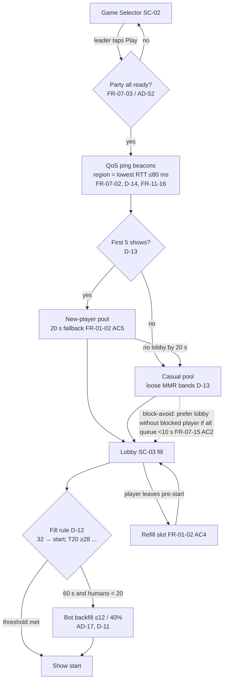
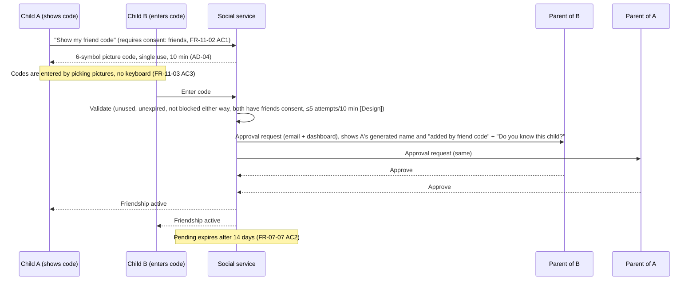
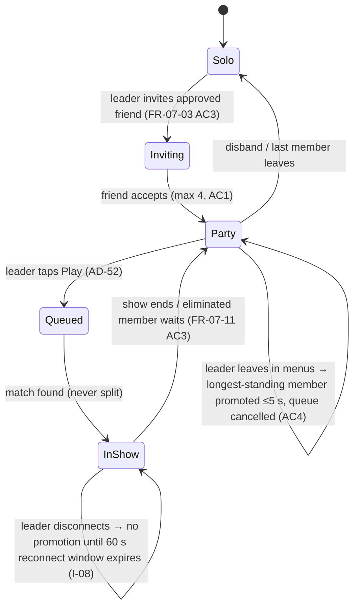
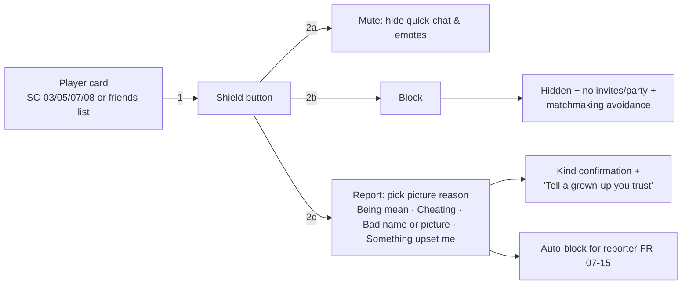
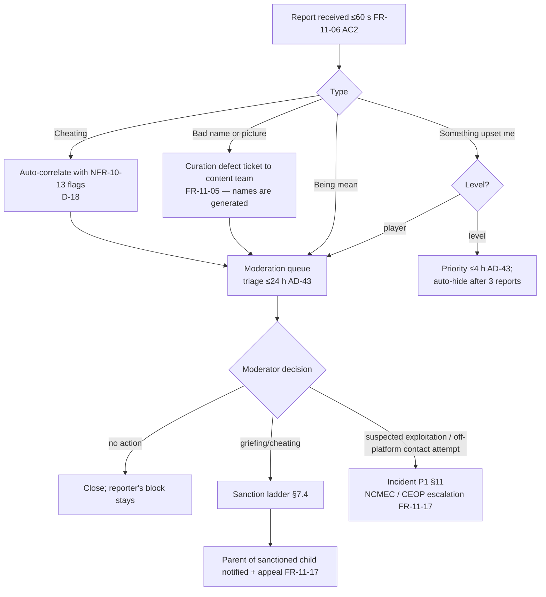
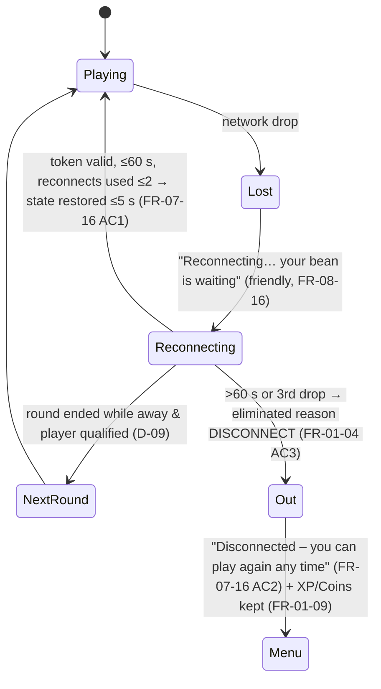
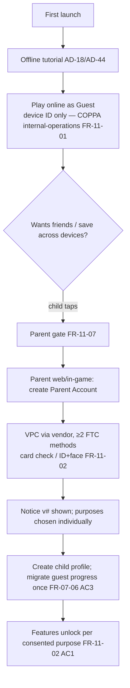

# 09 — Multiplayer, Social & Child Safety Design (Wobblebeans)

Status: Design v1 · 23 Oct 2026 · Owner: Multiplayer / Trust & Safety design
Sources (source of truth, in priority order): `Wobblebeans_Requirements_v3.docx` (Ch. 1, 7, 11, 13.5, 16; AD-01…AD-53), `07-multiplayer-social.md`, `11-child-safety-privacy.md`, gapfill-D (D-08…D-14).
Rule: every design element below cites the requirement(s) it realises. Anything not backed by a requirement is marked **[Design]** and listed in §14 for sign-off. Legal notes are design summaries, not legal advice (DEP-10).

---

## 1. Design pillars (traceability anchors)

| # | Pillar | Requirements |
|---|---|---|
| P1 | Everyone is a child; no adult/teen path in-game | UD-1, AD-01, FR-11-01 |
| P2 | No player-authored content between players: no text, no voice, generated names | AD-02, AD-03, FR-07-09/10 (Won't), FR-11-03, FR-11-04 |
| P3 | Strangers can play together but never contact each other | AD-02, AD-04, AD-19, FR-07-07, FR-07-08 |
| P4 | Parents decide; most protective defaults; child can't loosen | AD-22, FR-11-02, FR-11-08, FR-11-11 |
| P5 | No pressure: no leaver penalty, no countdowns, limits only at show end | AD-15, AD-23, AD-37, FR-11-15 |
| P6 | Safety in ≤ 2 interactions, picture-led, no typing | AD-43, FR-07-14/15, FR-11-06 |
| P7 | Minimise, truncate, delete | AD-21, FR-11-12, FR-11-16, NFR-10-21 |

---

## 2. Identity model

| Identity | Who | Social features | Data | Req |
|---|---|---|---|---|
| **Guest** | Child, no account | Matchmaking, quick-chat (receive/send preset), emotes, block/mute, report. **No** friends, parties, Private Shows, online status | Random device-scoped ID, device class, gameplay events | FR-07-06 AC1, FR-11-01 AC2, AD-22 |
| **Child profile** | Child under a Parent Account (max 4/parent) | Above + friends, parties, Private Shows (R2), only for purposes with consent | Pseudonymous profile ID, progress, friend graph, blocks, reports made | FR-07-06, FR-11-02 AC1 |
| **Parent Account** | Verified adult (VPC) | Never appears in-game; dashboard + controls only | Email, consent records (method, time, purposes, notice version) | FR-11-02 AC3, FR-11-10 |
| **Bot** | Server-side | None; cannot be friended, partied or reported into moderation | — | AD-17, D-11 |

Display names: Adjective + Noun + 2 digits, ≤ 16 chars, 5 re-rolls/day, curated per FR-11-05 (FR-11-04, AD-03). Platform account names never shown (FR-11-04).

---

## 3. Matchmaking & lobby UX

### 3.1 Flow


### 3.2 Rules
- Parties never split; same team in team shows (FR-01-02 AC2, AD-52). Team lobbies filled by whole parties (D-12).
- Region widens to ≤ 150 ms after 90 s; never > 200 ms; no kick for latency (D-08, D-14). Region from ping, never location (FR-11-16).
- Lobby screen SC-03 shows: party members (top), lobby fill as a friendly bean-counter (no ticking countdown — AD-15), "Some players may be computer players" (AD-17), player cards (generated name, costume, banner, title — FR-05 player card). **No** platform names, levels of spend, or country flags (FR-11-11, FR-11-16).
- Player card actions (lobby, spectate, results, friends list): **Mute · Block · Report** each reachable in ≤ 2 interactions (FR-07-14 AC2, FR-07-15 AC1, FR-11-06 AC1). There is **no** "Add friend" on a stranger's card (AD-04).
- Leaving a lobby or show: one confirm, no penalty (AD-37).

### 3.3 Bot backfill rules (consolidated)
| Rule | Value | Req |
|---|---|---|
| Modes | Casual only; disabled in Private Shows and (n/a) Ranked | AD-17, D-11, AD-16 |
| Trigger | < min_real (20) humans at 60 s step | D-11 |
| Cap | ≤ 12 bots / ≤ 40 % of lobby — **also applies to new-player lobbies** (Issue I-07) | AD-17 |
| Final | Bots never reach a Final; rank below humans before the Final | AD-17, FR-01-02 AC7 |
| Disclosure | SC-03 line + FAQ; parent privacy notice | AD-17, FR-11-13 |
| All-bots | Show ends at once, no winner recorded | Ch.1 edge case 9 |
| Names | Drawn from same curated generator **[Design]** so bots are indistinguishable in play, disclosure is at lobby level | AD-03, AD-17 |
| Interaction | Bots never send quick-chat or emotes **[Design]** (avoids fake social pressure, AD-15 spirit); reports on bots are acknowledged to the child normally and discarded server-side | FR-11-06 |

---

## 4. Friends & friend codes


- Both parents approve **[Design, resolves I-04]**; FR-07-07 says "every new friend needs approval in the Parent Account" — interpreted as each side's parent.
- Friend codes use a picture alphabet (e.g., 6 of 16 icons) so 6-year-olds can enter them without text fields (FR-11-03 AC3) **[Design]**.
- Platform-friend import: parent-only, behind parent gate, each import still per-friend approved (AD-04, FR-11-07).
- No name search API (FR-07-07 AC1). Online status visible to approved friends only (FR-07-07 AC4, FR-11-11).
- Remove/block friend ≤ 2 interactions (FR-07-07 AC3). Removal is silent to the other child **[Design]**.
- Friend requests are "off by default" (FR-07-07): the "Show my friend code" button is hidden until the parent grants the friends consent purpose.

## 5. Parties


- Invites only to approved friends; blocked players can't invite or join (FR-07-15 AC2).
- Leader changing show while members in Level Hop is blocked with message (Ch.1 edge 7).
- Parties are the only place a child sees "who they know"; party members are listed first in spectate (FR-07-11 AC2).

## 6. Communication: quick-chat & emotes only

| Aspect | Design | Req |
|---|---|---|
| Channel | Lobby, rounds, results. Payload = phrase ID (uint8); client renders localised string | FR-07-14 AC3, FR-11-03 AC2 |
| Set | ≤ 16 positive/neutral phrases (launch 8 listed) + icons; FR-11-05 review per language | FR-07-14, FR-11-05 |
| Input | Radial wheel, ≤ 2 inputs | FR-07-14 AC1 |
| Rate | 1 msg / 2 s per player; excess dropped silently | FR-07-14 AC1 |
| Emotes | 4 equipped, cancel on any input, not while airborne/grabbing/ragdolled; rate 1 / 2 s **[Design]** | FR-05-06, AD-34 |
| Audience | Whole lobby in lobby/results; in rounds, only beans within view **[Design]**; spectators' quick-chat goes to party only **[Design, I-06]** | FR-07-11 |
| Mute | Mute all / mute one player ≤ 2 interactions; parent can disable quick-chat entirely (on by default) | FR-07-14 AC2, FR-11-08 |
| Repetition abuse | Same phrase to same target ×5 in 30 s → sender's quick-chat soft-throttled to 1 / 10 s for 60 s **[Design]**; a phrase list with no negative phrases keeps worst case low | FR-07-14 |

Explicit **Won'ts** (negative tests): voice (no mic permission, FR-07-09, FR-11-03 AC1), text chat (FR-07-10), custom names (FR-11-04 AC2), free-text report descriptions (FR-11-03).

## 7. Block, mute, report

### 7.1 Child flow

"Shield" = one tap opens the three choices; the choice is tap 2 (≤ 2 interactions: FR-07-15 AC1, FR-11-06 AC1). Report = choose reason as the second tap (the reason icons are shown directly in the shield sheet) **[Design]**.

### 7.2 Report context (auto, no typing — FR-11-06)
show ID, round, reporter & reported pseudonymous IDs, phrase-ID/emote log for last 60 s, 30 s server replay snippet (server-side state, no client capture), reason code. Level reports add level ID & version.

### 7.3 Moderation pipeline


### 7.4 Sanction ladder **[Design]** (bound by FR-11-17, AD-37)
No automated sanctions from report counts alone for players (avoids brigading; AD-43's auto-hide applies to levels). Server-detected cheats are removed from the show immediately (NFR-10-13 AC3).
1. Warning card (picture-led, kind wording) + parent email.
2. 24 h online suspension (offline Practice Playground still available, AD-18).
3. 7-day suspension. 4. Profile online ban, parent appeal.
Name issues → forced re-roll (doesn't count against 5/day).

## 8. Private Shows (R2)
FR-07-08, AD-19: host invites approved friends only; no join codes; 2–32 players; 0 XP / 0 Coins; host migrates to longest-standing; no bots (D-11). Min players: 2 solo / 2 full teams (AC1). Gated on friends consent. Block rules apply (blocked player can't be invited). Quick-chat same as public.

## 9. Spectating
FR-07-11, AD-36: on elimination → "Watch" or "Leave"; cycle players, party first, auto-switch 2 s after target finishes/eliminated; HUD shows timer + qualified count. Spectator view shows generated names only; player card actions (mute/block/report) available. Spectators cannot be seen by players and their emotes are not broadcast to the lobby **[Design]**. Leaving returns to menu; rejoin party at show end (AC3).

## 10. Disconnect / reconnect UX


- Bean frozen (race: can be knocked; survival/team: counts present); team points frozen (D-09, FR-07-16 AC3). Quota not recomputed (FR-01-04 AC3).
- Party members are not blocked; they continue (D-09). No leaver penalty (AD-37). Trophy idempotent on reconnect (FR-06 AC1).
- Crash-restart: client offers "Jump back in?" on launch within window (D-09 AT).
- Playtime limit reached → applied at show end, never mid-round (FR-11-15 AC2).

## 11. Parental dashboard & controls

| Feature | Default | Effect timing | Req |
|---|---|---|---|
| Consent per purpose: online play, friends, Builder sharing | Off until VPC | Withdraw ≤ 1 h + deletion starts | FR-11-02 |
| Approve/remove friends, pending list | — | ≤ 5 min / next show | FR-11-08, FR-11-10 |
| Quick-chat | On (preset only) | next show, ≤ 5 min | FR-11-08 |
| Builder / sharing | Builder per scope; sharing Off | — | FR-11-08, AD-20 |
| Break reminder | 60 min (30–120), only parent can disable | next show end | AD-23, FR-11-15 |
| Daily limit | Off | end of show | FR-11-15 |
| Cross-play (Later) | On when shipped, parent can disable | — | FR-07-05, AD-51 |
| Activity: playtime/day 30 d, friends, reports made, blocks, Trophies, Season Path | — | data ≤ 15 min old | FR-11-10 |
| **Moderation actions on my child + appeal** | — | on action | FR-11-17 **(I-10)** |
| Purchases | Off, cannot enable in MVP; history empty | — | FR-11-09, AD-12 |
| Data view / export JSON (≤72 h) / delete (≤30 d) | — | — | FR-11-12 |
| Weekly summary email | Opt-in | weekly | FR-11-19 |

Parent gate (sum-in-words, 3 fails → 5 min lock, back doesn't bypass) + Parent Account sign-in for any change (FR-11-07). No settings loosening from the child profile (FR-11-11).

## 12. Consent & data flows

### 12.1 Onboarding / consent


### 12.2 Data inventory (social/safety slice — feeds FR-11-01 AC1)
| Element | Purpose | Basis | Retention | Consent? |
|---|---|---|---|---|
| Device/profile pseudonymous ID | run game, security, progress | COPPA internal ops / legitimate interest + contract (GDPR-K) | life of profile; guest local | No |
| Truncated IP (/24, /48) | connection, security | internal ops | raw ≤ 24 h | No (FR-11-16) |
| QoS RTT per region | region choice | internal ops | 90 d raw (AD-21) | No |
| Hidden MMR | matchmaking | internal ops (FR-11-14) | profile life | No |
| Quick-chat/emote ID logs | moderation context | safety | 90 d raw; attached to report per §12.3 | No |
| Friend graph, blocks | social features | consent "friends" | until removed / deletion | Yes (friends) |
| Reports made / about | safety | legal obligation / safety | §12.3 | No |
| Replay snippets (flagged) | moderation | safety | 14 d (AD-21) unless legal hold | No |
| Parent email, consent records | VPC, notices | legal obligation | retained as legally required (NFR-10-21) | — |
| Anti-cheat device data (if vendor) | security | must be in DPIA | per DPIA | NFR-10-13, NFR-11-01 |

### 12.3 Retention resolution for safety evidence
Default flagged-replay retention 14 d (AD-21). **Legal hold** extends retention for cases escalated to NCMEC/CEOP/law enforcement per statutory preservation duties (US 18 U.S.C. §2258A preservation, currently 1 year) — covered by the "legally required safety records" carve-out in FR-11-12 AC2 / NFR-10-21 (I-05). Counsel sign-off (DEP-10).

### 12.4 Regulatory mapping (summary)
COPPA: child-directed, VPC before non-internal collection, parent review/delete (FR-11-01/02/12). UK Children's Code: Std 2 DPIA (NFR-11-01), 7 default settings (FR-11-11), 8 minimisation (AD-21), 10 geolocation off (FR-11-16), 11 parental controls transparency — child sees a small "a grown-up can see your play time" icon **[Design]**, 12 no profiling (FR-11-14), 13 no nudges (AD-15), 15 online tools (FR-07-14/15, FR-11-06). GDPR Art 8: parental consent for consent-based processing; UK age 13, EU member-state 13–16 — we treat all as children, so VPC is used regardless (AD-01). OSA 2023: children's risk assessment (NFR-11-01), reporting + complaints (FR-11-06/17).

## 13. Incident response

```mermaid
flowchart TD
  D[Detect: report, anti-cheat, telemetry anomaly, parent email, press] --> C{Severity}
  C -->|P1 child-exploitation indicator,<br/>data breach, safety-control bypass e.g. string in protocol| P1[Page on-call T&S lead + DPO ≤15 min]
  C -->|P2 mass griefing, curated-string defect, moderation SLA breach| P2[T&S lead ≤4 h]
  C -->|P3 single abuse case| P3[Normal queue ≤24 h]
  P1 --> K[Contain: kill-switch config<br/>quick-chat off globally / friend codes off / feature flag]
  K --> E[Preserve evidence legal hold §12.3]
  E --> R{Reportable?}
  R -->|CSAM/exploitation| N[NCMEC CyberTipline (US) / CEOP / police (UK) FR-11-17]
  R -->|personal-data breach| B[ICO ≤72 h (UK/EU GDPR Art 33); FTC/state notice per COPPA counsel; parents informed]
  N --> PM[Post-mortem ≤5 working days; DPIA/risk-assessment update NFR-11-01]
  B --> PM
  P2 --> PM
```
Kill switches **[Design]** (config-driven, NFR config req): `quickchat.enabled`, `friendcode.enabled`, `privateshows.enabled`, `phrase.<id>.enabled`, `namegen.word.<id>.enabled` (forces re-roll for affected names). Runbooks + contacts approved pre-launch (FR-11-17 AC1); monthly SLA report ≥ 95 % (AC2). Admin tools MFA + audit logs (AD-41).

---

## 14. Issues found and resolutions

| ID | Issue | Source conflict | Resolution (proposed; needs owner/counsel OK where noted) |
|---|---|---|---|
| I-01 | Guest can play a full online show without consent (FR-07-06 AC1), yet FR-11-02 lists "online play" as a consent purpose | FR-07-06 vs FR-11-02 | Guest online play relies on COPPA internal-operations exception: no social graph, preset comms only, pseudonymous ID. "Online play" consent purpose governs persistent profile online features (cross-device sync, friends' visibility). Clarify FR-11-02 wording. **Counsel** |
| I-02 | Quick-chat for guests not specified | FR-07-14 silent | Allowed (preset IDs, no personal data); parent can't control a guest, so guests get quick-chat **receive+send** but mute-all is one tap. Revisit in DPIA |
| I-03 | Friend code entry requires a text field, but child profiles have none | FR-07-07 vs FR-11-03 AC3 | Picture-alphabet codes (6 of 16 icons) |
| I-04 | Ambiguous whose parent approves a friendship; a shared/screenshotted code could let a stranger in | FR-07-07, AD-04 | Both parents approve; approval card shows "added by code" and "Do you know this child in real life?"; ≤5 code attempts per 10 min |
| I-05 | Flagged replay retention 14 d (AD-21) shorter than evidence preservation needed for NCMEC/CEOP escalations | AD-21 vs FR-11-17 | Legal-hold exception under NFR-10-21 "legally required safety records". **Counsel** |
| I-06 | Spectator communication undefined (could message active players) | FR-07-11, FR-07-14 | Spectator quick-chat to party only; spectators invisible to players |
| I-07 | Bot share in new-player lobbies unbounded ("disclosed bots", D-13) | FR-01-02 AC5 vs AC7 | 40 % / 12-bot cap applies to all lobbies |
| I-08 | Leader-disconnect promotion in 5 s (FR-07-03) clashes with 60 s reconnect window mid-show (D-09) | FR-07-03 vs FR-07-16 | 5 s promotion in menus/queue only; in a show, promotion waits for window expiry |
| I-09 | Disconnect wording differs: "Disconnected – you can play again any time" vs "eliminated – disconnected" | FR-07-16 AC2 vs D-09 AT | Use FR-07-16 wording (FR-08-16 friendly language); update D-09 AT |
| I-10 | Parent dashboard shows reports the child *made*, but not moderation actions *against* the child, though FR-11-17 requires a parent appeal path | FR-11-10 vs FR-11-17 | Add "Safety notices & appeals" section to dashboard + email |
| I-11 | "Bad name or picture" report against generated names/curated cosmetics can't be the child's fault | FR-11-06 vs AD-03 | Route to curation defect queue; offending word disabled via kill switch; no sanction on reported child |
| I-12 | Report auto-hide after 3 reports (AD-43) — unclear if it applies to players; risk of brigading | AD-43 | Levels only; players never auto-sanctioned by report count |
| I-13 | Reports on bots would waste moderation and could reveal bot identity if handled differently | AD-17, FR-11-06 | Same child-facing confirmation; silently discarded server-side |
| I-14 | Emote spam/rate limit undefined | FR-05-06 | 1 emote / 2 s, mirroring quick-chat |
| I-15 | Block avoidance only "when alternative lobby < 10 s"; a blocked player can still share a show | FR-07-15 AC2 | Accept (pool health), since no contact channel exists; blocked player's emotes/chat hidden and their bean gets no player-card from blocker's view |
| I-16 | Anti-cheat vendor may collect device data from children | NFR-10-13, Q-C3 | Prefer server-side only for MVP; any vendor needs DPIA entry and parent notice before enabling |
| I-17 | Children's Code Std 11 (parental monitoring transparency) has no child-facing indicator | FR-11-13 | Child sees a small icon/explainer that a grown-up can see playtime & friends |

Open for owner: Q-C2 (launch countries → regions & GDPR-K ages), Q-C3 (anti-cheat vendor), DEP-10 counsel sign-off on I-01, I-05.

## 15. Verification hooks
T-FR-01-02, T-FR-07-02/03/06/07/08/11/14/15/16, T-FR-11-01…19, T-NFR-11-01, T-NFR-10-13/21. Added design tests: picture friend-code entry by 6–8 year olds (≥80 % unaided); both-parent approval E2E; spectator chat scope; leader-disconnect-in-show; bot-report discard; kill-switch drill (each flag effective ≤ 5 min); legal-hold retention audit.
